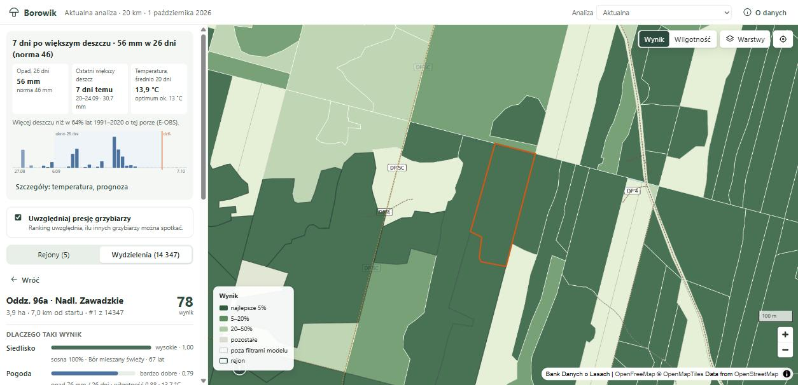
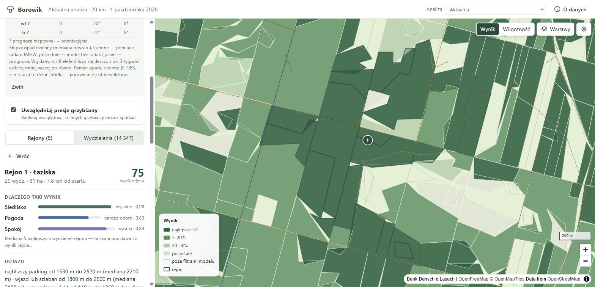
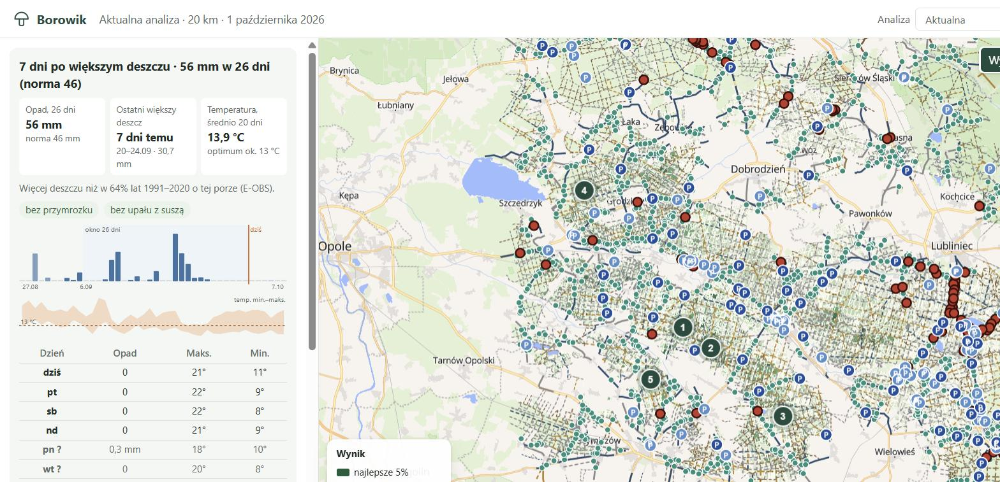
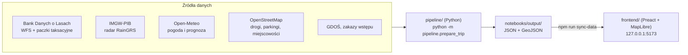

# Borowik

**Gdzie jechać na prawdziwki?** Borowik ocenia każde wydzielenie leśne w promieniu 10–50 km od wybranego punktu i układa z nich ranking miejsc wartych odwiedzenia. Łączy dane o drzewostanie z Banku Danych o Lasach, opady z radaru IMGW, prognozę pogody i przybliżoną liczbę innych grzybiarzy. Wynik pokazuje na mapie w przeglądarce.



## Co potrafi

- **Ranking wydzieleń i rejonów**: każde wydzielenie dostaje wynik 0–100. Najlepsze, leżące blisko siebie, są łączone w maksymalnie pięć rejonów poszukiwań.
- **Wyjaśnienie wyniku**: trzy paski „więcej = lepiej” (Siedlisko, Pogoda, Spokój) rozwijane do składowych, skład drzew, wiek, typ siedliska, najbliższy parking, wjazd i utwardzony dukt.
- **Pogoda w obszarze**: opad z ostatnich 26 dni na tle normy 1991–2020, ostatni większy deszcz, temperatury i prognoza na 7 dni.
- **Mapa** (MapLibre): kolorowanie według wyniku albo wilgotności oraz warstwy parkingów, wjazdów, szlabanów i dróg leśnych według nawierzchni.
- **Wykluczenia**: rezerwaty i parki narodowe (GDOŚ) oraz bieżące zakazy wstępu do lasu (dla najlepszych wydzieleń).
- **Zapisane analizy**: zamrożone migawki wcześniejszych wyjazdów do porównania.
- **Mapa na telefon**: eksport KMZ z najlepszymi wydzieleniami i parkingami do Locus Map lub Guru Maps, do użycia w lesie bez internetu.
- **Launcher dla Windows**: analiza, synchronizacja i otwarcie przeglądarki jednym kliknięciem, bez terminala.

| Karta rejonu | Panel pogody |
|---|---|
|  |  |

## Jak to działa



Obliczenia wykonuje Python. Frontend tylko czyta przygotowane pliki i nie ma własnego serwera API. Wynik wydzielenia to:

```
R = 100 × H × F_loc × (1 − α × P)        (α = 0,3; R = 0 poza maską)
```

- **H (siedlisko)**: powinowactwo gatunków drzew do borowika, typ siedliskowy lasu i wiek drzewostanu.
- **F_loc (pogoda)**: wilgotność z opadów i parowania w oknie 26 dni (radar IMGW scalony z Open-Meteo), temperatura, przymrozek i sezonowość, z lokalną korektą.
- **P (presja)**: ilu innych grzybiarzy może dotrzeć do lasu. Ludność okolicznych miejscowości jest rozdzielana między punkty dostępu (parkingi, wjazdy) modelem Huffa.
- **Maska** odrzuca obszary nieleśne, drzewostany młodsze niż 35 lat i lasy z przewagą gatunków niesprzyjających borowikowi.

Wszystkie wagi i progi są w [`profiles/boletus_edulis.yaml`](profiles/boletus_edulis.yaml). Pełna definicja modelu jest w [opisie technicznym](docs/Borowik_opis_techniczny_i_walidacja.md).

> **To model ekspercki, nieskalibrowany na danych z terenu.** Wynik porównuje miejsca w ramach jednej analizy. R = 80 nie oznacza 80% szans na znalezienie grzybów. Co wiadomo o trafności, opisuje [walidacja](#walidacja).

## Wymagania

- **Python 3.12+** i [uv](https://docs.astral.sh/uv/)
- **Node.js 22.12+** (sprawdzone na Node 24)
- Dostęp do internetu (wszystkie dane są pobierane z publicznych usług i zapisywane w `cache/`)
- Windows 10/11 dla launchera. Pipeline i frontend są międzyplatformowe, ale polecenia poniżej podano dla PowerShell.

## Instalacja

```powershell
git clone https://github.com/julekD82/borowik.git
cd borowik
uv sync                      # tworzy .venv z zależnościami Pythona
cd frontend
npm ci                       # zależności frontendu
cd ..
```

## Uruchomienie

### Launcher (Windows)

```powershell
.venv\Scripts\pythonw.exe launcher\launcher.pyw
```

Podaj współrzędne punktu startowego, promień i nazwę miejsca, a potem kliknij **Uruchom analizę i podgląd**. Launcher sam uruchomi obliczenia, zsynchronizuje dane i otworzy przeglądarkę. Z launchera można też zapisać migawkę analizy, przygotować mapę na telefon i udostępnić aplikację w sieci lokalnej. Wygodnie jest utworzyć skrót do powyższego polecenia na pulpicie.

### Z wiersza poleceń

```powershell
# 1. Analiza (pierwsze uruchomienie dla nowego obszaru pobiera dane i trwa dłużej; kolejne korzystają z cache/)
uv run python -m pipeline.prepare_trip --lat 50.53 --lon 18.61 --radius-km 20

# 2. Skopiowanie wyników do frontendu i start serwera
cd frontend
npm run sync-data
npm run dev                  # http://127.0.0.1:5173
```

Najważniejsze opcje `prepare_trip`:

| Opcja | Znaczenie |
|---|---|
| `--lat`, `--lon` | Punkt startowy (WGS84) |
| `--radius-km` | Promień analizy, 10–50 km (domyślnie 25) |
| `--date` | Data wyjazdu, najwyżej 15 dni naprzód. Pogoda jest liczona z prognozą do tego dnia |
| `--bdl-packages-dir` | Katalog z rozpakowanymi paczkami BDL (pełny skład gatunkowy, patrz niżej) |
| `--population-grid-path` | Siatka ludności GUS 1 km (NSP 2021) zamiast populacji z OSM |
| `--no-radar` | Opady tylko z Open-Meteo, bez radaru IMGW |

Szczegóły interfejsu i synchronizacji danych: [`frontend/README.md`](frontend/README.md).

### Opcjonalne dane lokalne

Aplikacja działa bez nich, ale z nimi wynik jest dokładniejszy:

- **Paczki BDL nadleśnictw** zawierają pełny skład gatunkowy drzewostanu (WFS podaje tylko gatunek panujący). Zamawia się je bezpłatnie przez formularz na [bdl.lasy.gov.pl](https://www.bdl.lasy.gov.pl/portal/wniosek), a link do pobrania przychodzi e-mailem. Rozpakowane paczki wskaż w `local_config.json`.
- **Norma opadów E-OBS** (panel pogody): `uv run python scripts/pobierz_eobs.py` pobiera dane E-OBS dla Polski do `cache/eobs/` (12 plików po ok. 1 GB, po konwersji surowe pliki są kasowane). Bez nich panel nie pokazuje normy.

`local_config.json` w katalogu głównym (nie trafia do gita, wzór w [`local_config.example.json`](local_config.example.json)):

```json
{
  "bdl_packages_dir": "BDL",
  "telefon_dir": "dane_telefon"
}
```

## Testy

```powershell
uv run pytest                # testy pipeline'u (Python)
cd frontend
npm test                     # testy frontendu (Vitest)
npm run build                # kontrola typów TypeScript + build produkcyjny
```

## Struktura repozytorium

```
pipeline/           model i pobieranie danych (BDL, IMGW, Open-Meteo, OSM, GDOŚ), ranking, rejony, eksport
profiles/           profil gatunku: wagi, progi i parametry modelu (YAML)
frontend/           interfejs w przeglądarce (Preact, MapLibre, Vite)
launcher/           okienkowy launcher dla Windows (Tkinter)
scripts/            narzędzia: eksport na telefon, dziennik wyjść, pobieranie danych walidacyjnych, analizy faz
notebooks/          skrypty badawcze: backtesty, walidacja na GBIF i danych z Bielefeld
dane_walidacyjne/   zamrożone zbiory walidacyjne (GBIF z pseudonimami, Bielefeld)
tests/              testy pytest
docs/               dokumentacja; docs/archiwum/ to historia rozwoju projektu
```

## Dokumentacja

| Dokument | Zawartość |
|---|---|
| [Opis techniczny i walidacja](docs/Borowik_opis_techniczny_i_walidacja.md) | Pełny opis modelu, źródeł danych, ograniczeń i tego, co wiadomo o trafności |
| [Frontend](frontend/README.md) | Uruchamianie interfejsu, synchronizacja danych, zachowanie widoków |
| [Mapa na telefon](docs/TELEFON.md) | Eksport KMZ do Locus Map / Guru Maps |
| [Zapis wyjść](docs/ZAPIS_WYJSC.md) | Jak notować wyjazdy i znaleziska, żeby kiedyś ocenić aplikację |
| [Słownik pól BDL](docs/BDL_slownik_pol.md) | Pola paczek BDL i ich użycie w modelu |
| [Reguły walidacji](docs/WALIDACJA_REGULY.md), [implementacja](docs/WALIDACJA_IMPLEMENTACJA.md), [wyniki](docs/RAPORT_FAZA_2.md) | Walidacja na rekordach GBIF |
| [Reguły](docs/WALIDACJA_BIELEFELD.md) i [wyniki](docs/RAPORT_BIELEFELD.md) walidacji Bielefeld | Porównanie z dziesięcioletnim monitoringiem owocników |
| [Archiwum](docs/archiwum/README.md) | Plany, specyfikacje i raporty z kolejnych etapów rozwoju |

## Walidacja

Krótko, bez upiększeń (szczegóły w [opisie technicznym](docs/Borowik_opis_techniczny_i_walidacja.md), rozdział 14):

- **Pogoda (F)**: w backteście na 90 obserwacjach GBIF dzień rzeczywistego znaleziska wypada średnio na pozycji 0,626 wśród dni porównawczych (0,5 = brak rozróżnienia).
- **Radar**: w krótkim porównaniu opady RainGRS zgadzały się z czterema lokalnymi stacjami lepiej niż sam model Open-Meteo.
- **Siedlisko (H)** i **presja (P)** nie mają niezależnej walidacji terenowej. Nie ma też miary skuteczności całego rankingu.
- Model „fazy wysypu” po deszczu przetestowano i odrzucono, bo wypadł gorzej niż punkt odniesienia.

## Źródła danych

| Źródło | Użycie | Warunki |
|---|---|---|
| [Bank Danych o Lasach](https://www.bdl.lasy.gov.pl/) (Lasy Państwowe) | Geometrie i opisy wydzieleń, zakazy wstępu, drogi pożarowe | Dane publiczne BDL |
| [IMGW-PIB](https://danepubliczne.imgw.pl/) | Radar opadowy RainGRS | Źródłem pochodzenia danych jest Instytut Meteorologii i Gospodarki Wodnej – Państwowy Instytut Badawczy. Dane zostały przetworzone |
| [Open-Meteo](https://open-meteo.com/) | Pogoda bieżąca, prognoza i klimatologia | CC BY 4.0 |
| [OpenStreetMap](https://www.openstreetmap.org/copyright) | Drogi, parkingi, miejscowości | © współtwórcy OpenStreetMap, ODbL |
| [GDOŚ](https://sdi.gdos.gov.pl/) | Rezerwaty i parki narodowe | Dane publiczne GDOŚ |
| [E-OBS](https://surfobs.climate.copernicus.eu/) | Norma opadów, walidacja | Tylko niekomercyjne badania i edukacja. Cornes i in. (2018), doi:10.1029/2017JD028200 |
| [GBIF](https://www.gbif.org/) | Sezonowość i walidacja | Licencje rekordów (CC0, CC BY, CC BY-NC); obserwatorzy zastąpieni pseudonimami |
| [Brejon Lamartinière & Hoffman](https://doi.org/10.5281/zenodo.20591123) | Monitoring owocników koło Bielefeld (walidacja) | CC BY 4.0 |
| [OpenFreeMap](https://openfreemap.org/) | Podkład mapy | © OpenMapTiles, dane OpenStreetMap |

## Licencja

Projekt prywatny. Wszelkie prawa zastrzeżone. Dane zewnętrzne podlegają warunkom źródeł wymienionych powyżej.
