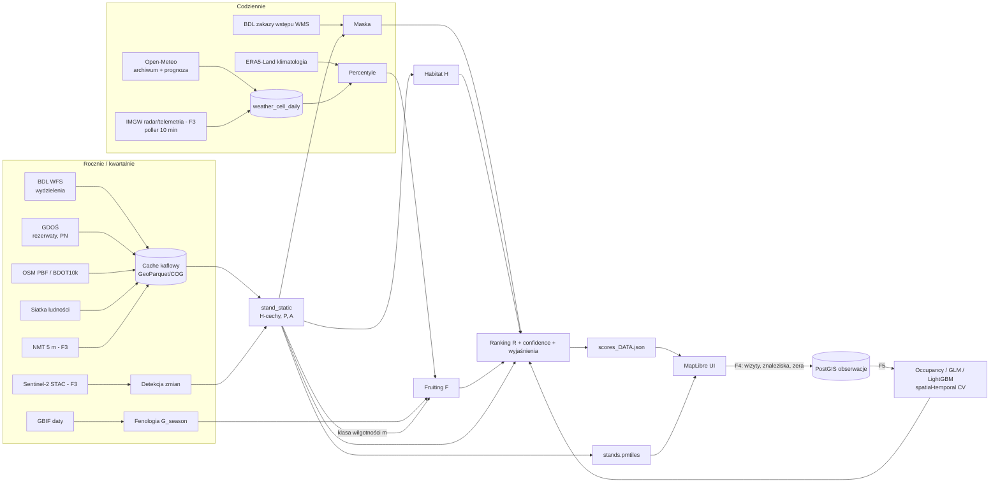

# Borowik GIS — projekt systemu typowania miejsc owocnikowania *Boletus edulis*

> Wersja 1.0 · 2026-09-23 · dokument projektowy (przed implementacją)
>
> Konwencja: **[Z]** = zweryfikowane w tej sesji (zapytanie do API / lektura źródła), **[L]** = literatura naukowa, **[E]** = wiedza ekspercka / prior do kalibracji, **[?]** = do sprawdzenia przy implementacji.

---

## 0. Najważniejsze wnioski

1. **Najmocniejszą, najtańszą i najdokładniejszą zmienną jest drzewostan z Banku Danych o Lasach.** Publiczny WFS BDL [Z] zwraca dla każdego wydzielenia Lasów Państwowych: typ siedliskowy lasu, gatunek panujący, jego udział, wiek, budowę drzewostanu i typ powierzchni. Robi to w ~0,5 s dla kwadratu 10×10 km. Z tego jednego źródła da się zbudować około 70% wartości MVP.
2. **„Fruiting score” jest najsłabszą częścią systemu i nie może udawać precyzji.** Nawet 10 lat niemal wyczerpującego monitoringu populacji *B. edulis* pod Bielefeld [L1] dało tylko ogólne prawidłowości: optimum ok. 13 °C i dodatni, liniowy wpływ opadu w oknach 3–4 tygodni. Nie powstała reguła typu „X mm → owocniki po Y dniach”. Fruiting pokazujemy więc w **4 klasach**, a nie jako liczbę 0–100.
3. **W promieniu 20 km pogoda różnicuje przestrzeń słabo** (temperatura prawie wcale, opad umiarkowanie, przy burzach mocno). Ranking *miejsc* w danym dniu wynika głównie z siedliska. Fruiting mówi przede wszystkim **„czy w ogóle warto jechać w tym tygodniu”** i **„w której części obszaru padało”**.
4. **Jako model zamiast trzech sumowanych score’ów proponuję model multiplikatywny z bramkami (hard mask) i osobną warstwą niepewności.** Doskonałe siedlisko bez warunków do owocnikowania to 0 szans, a nie 50/100. Presja ludzi to preferencja użytkownika (suwak), a nie biologia.
5. **Siatka 10 m to fałszywa precyzja.** Jednostką obliczeniową jest **wydzielenie leśne** (typowo 1–10 ha), a dane pogodowe przypinamy do komórek 1–9 km. Mikrotopografia wchodzi dopiero później, jako modyfikator wewnątrz wydzielenia, i tylko w terenie urozmaiconym.
6. **Satelitarna wilgotność gleby (Sentinel-1 / CLMS SWI) jest dla lasu słaba**, bo radar pasma C słabo przenika zwarte korony. Lepszy jest prosty model bilansu wodnego (opad − ET0) z pojemnością wodną zależną od typu siedliska.
7. **NDVI/NDMI prawie nie przewidują tygodniowego owocnikowania.** Są za to bardzo przydatne do wykrywania zrębów, wydzielania świerczyn po kornikowych szkodach i innych zmian od ostatniej aktualizacji BDL.
8. **GBIF/iNaturalist nie nadają się do trenowania modelu przestrzennego.** W całej Polsce jest tylko **1164** georeferencjonowanych rekordów *B. edulis* [Z], a 1073 z nich pochodzą z iNaturalist. Mają silny bias drogowy. Nadają się do fenologii (kiedy sezon), nie do lokalizacji (gdzie).
9. **Twoje własne obserwacje „szukałem i nic nie znalazłem” z zapisanym wysiłkiem (czas, ślad GPS) są najcenniejszymi danymi w całym projekcie.** Pasują dokładnie do klasy modeli *occupancy / detection*, w której „siedlisko” i „owocnikowanie teraz” są naturalnie rozdzielone.
10. **Obowiązkowa maska prawna:** rezerwaty, parki narodowe, uprawy do 4 m wysokości, drzewostany nasienne, okresowe zakazy wstępu (art. 26 ustawy o lasach). System, który poleca uprawę albo rezerwat, jest gorszy niż brak systemu.

---

## 1. Problem biologiczny

### 1.1 Taksonomia: co właściwie typujemy?

W polskiej praktyce grzybiarskiej „prawdziwek” to grupa gatunków o różnych preferencjach:

| Gatunek | Główni partnerzy | Uwagi |
|---|---|---|
| *Boletus edulis* s.str. (borowik szlachetny) | świerk, sosna, buk, dąb, brzoza, jodła | najszersza amplituda siedliskowa |
| *Boletus pinophilus* (b. sosnowy) | sosna, rzadziej świerk | bory, często wcześniej lub później w sezonie |
| *Boletus reticulatus* (b. usiatkowany) | dąb, buk, grab | cieplejszy, **wcześniejszy** (czerwiec–lipiec) |
| *Boletus aereus* (b. ciemnobrązowy) | dąb, buk | rzadki, ciepłe stanowiska |

**Wniosek projektowy:** profile gatunków trzymać w konfiguracji (YAML): partnerzy, siedliska, okno fenologiczne. MVP liczy jeden profil „prawdziwki (grupa *B. edulis*)” z dominacją *B. edulis* s.str. Wybór gatunku w UI to w praktyce zmiana profilu. Ten sam mechanizm obsłuży później kurki, podgrzybki czy rydze.

### 1.2 Zmienne: wartość predykcyjna i dostępność danych

Legenda: WP = wartość predykcyjna (W/Ś/N), Rozdz. = rozdzielczość, Trudn. = trudność pozyskania.

| Zmienna | Co wiadomo (i skąd) | WP | Dane PL | Rozdz. przestrz. | Rozdz. czas. | Trudn. |
|---|---|---|---|---|---|---|
| **Gatunki drzew (mikoryza)** | Grzyb ektomikoryzowy z bardzo szerokim spektrum żywicieli iglastych i liściastych [L1]. Bez żywiciela EcM nie ma owocników (olsze, jesiony i klony praktycznie odpadają). | **W** | BDL WFS: gatunek panujący + udział [Z]. Pełny skład na wniosek / w pakietach LMN [?] | wydzielenie (ha) | aktualizacja roczna (stan na 1 I), inwentaryzacja co 10 lat | niska |
| **Typ lasu / siedlisko** | Prawdziwki w PL: przede wszystkim ubogie i średnio żyzne, kwaśne siedliska (bory i bory mieszane świeże, lasy mieszane świeże; w górach świerczyny i buczyny) [E]. Brak ilościowych polskich studiów. | **W** | BDL `site_type` (np. BMŚW, BŚW) [Z] | wydzielenie | ~10 lat | niska |
| **Wiek drzewostanu** | Sprzeczne wyniki. Hiszpania (*P. sylvestris*): maksimum w drzewostanach 60–70-letnich [L2]. Finlandia (*Picea abies*): maksimum **przed pierwszą trzebieżą**, czyli w drzewostanach młodych [L3]. Zgoda co do jednego: uprawy i młodniki są słabe. | **Ś** | BDL `spec_age` [Z] | wydzielenie | roczna | niska |
| **Zagęszczenie / zwarcie** | Drzewostany zbyt rzadkie i zbyt gęste były mniej produktywne [L2]. | Ś | BDL (pełny opis: zwarcie) [?]; CHM z LiDAR [Z-dostępność] | wydz. / 1 m | 10 lat / kampania LiDAR | średnia |
| **pH, typ gleby, C/N** | W Puszczy Białowieskiej produkcja grzybów zależała głównie od bogactwa gatunków, a to od pH i C/N gleby [L4]. Borowik preferuje gleby kwaśne i ubogie w N [E, ogólna ekologia EcM]. | Ś | Brak dobrych map pH dla lasów. SoilGrids 250 m to model słabo ograniczony w lasach. **Typ siedliska z BDL jest lepszym proxy żyzności.** | 250 m (SoilGrids) | statyczne | średnia |
| **Wilgotność gleby** | W sosnowych lasach Hiszpanii satelitarna wilgotność gleby dorównywała opadowi (r = 0,63–0,72) [L5]. | **W** (czasowo) | ERA5-Land / modele NWP (Open-Meteo) [Z]; CLMS SWI 1 km [Z] | 1–9 km | dobowa | niska |
| **Opady (suma okienna)** | Liczba owocników rosła liniowo z opadem skumulowanym w oknie ok. **26 dni** [L1]. Na roczną produkcję opad wpływa najsilniej [L5]. | **W** (czasowo) | IMGW stacje + radar [Z], Open-Meteo [Z] | 1–9 km | godz./dob. | niska |
| **Lag opad → owocniki** | Brak twardej wartości. Ostre okna 5-dniowe słabo wyjaśniały owocnikowanie [L1 v1]; lepiej działały okna 20–26 dni [L1 v2]. Popularne „10–14 dni po deszczu” to hipoteza. | Ś | pochodna opadu | — | — | kalibracja |
| **Temperatura (średnia okienna)** | Kwadratowe optimum ok. **13 °C** średniej dobowej z ~20 poprzednich dni [L1]. Brak owocników przy średniej 5-dniowej > 17,5 °C połączonej z brakiem opadu [L1 v1]. | **W** | IMGW, Open-Meteo | 2–9 km | dobowa | niska |
| **Temp. nocna / minimalna** | Wychłodzenie jako „wyzwalacz” to popularna teza. Mocnych danych dla *B. edulis* nie znalazłem. Pewne: przymrozek kończy sezon. | N–Ś | jw. | jw. | jw. | niska |
| **Temp. 7/14/21/30 dni** | Z [L1] wynika, że istotne są okna ~20 dni. Liczymy je wszystkie, ale MVP używa jednego okna 20-dniowego, żeby nie mnożyć skorelowanych zmiennych. | W (jedno okno) | jw. | | | |
| **Długość okresu suchego** | Konsekwencja bilansu wodnego. Jako osobna zmienna redundantna z wilgotnością gleby. | Ś | pochodna | | | |
| **VPD / ET0** | ET0 potrzebne do bilansu wodnego. VPD istotne raczej dla wysychania owocników niż ich powstawania [E]. | Ś (ET0) / N (VPD) | Open-Meteo [Z] | 2–9 km | godz. | niska |
| **Ekspozycja stoku** | Na nizinach nieistotna. W terenie urozmaiconym działa przez mikroklimat (N zatrzymuje wilgoć w suche lata, S ogrzewa się późną jesienią) [E]. | N (niziny) / Ś (góry) | NMT 1 m GUGiK [Z-dostępność] | 1–5 m | statyczne | średnia |
| **Nachylenie** | Pośrednio (odpływ wody, erozja); w Białowieży wśród predyktorów [L4]. | N | NMT | 1–5 m | stat. | średnia |
| **Wysokość n.p.m.** | Na nizinie ~0. W górach przesuwa fenologię (sezon wcześniej lub później) i zmienia skład drzewostanu. | N (niz.) / Ś (góry) | NMT | | | |
| **TWI / zagłębienia** | Proxy lokalnej wilgotności; sens w latach suchych [E]. | Ś | pochodna NMT | 5–10 m | stat. | średnia |
| **NDVI (rok poprzedni)** | Najlepszy predyktor *rocznej* produkcji w Hiszpanii (r = 0,41–0,6) [L5]. Dla prognozy tygodniowej nieprzydatny. | N (tydzień) / Ś (rok) | Sentinel-2 | 10 m | 5 dni (chmury!) | średnia |
| **NDMI / red edge – zmiany** | Wykrywanie zrębów, obumierania (kornik), trzebieży od ostatniej aktualizacji BDL. | **W** (maska) | Sentinel-2 | 10–20 m | sezonowo | średnia |
| **LAI** | Dubluje zwarcie i NDVI. | N | S2 / CLMS | 10–300 m | | |
| **Temperatura powierzchni (LST)** | Pod koronami mierzy temperaturę koron, nie ściółki. Rozdzielczość 100 m–1 km. | N | Landsat / MODIS | 100 m–1 km | | pomijamy |
| **Zręby, rębnie** | Wycięcie żywiciela oznacza utratę owocników na lata. Uprawy do 4 m są i tak objęte zakazem wstępu. | **W** (maska) | BDL (wiek, typ pow.), S2 change | wydz. | | niska |
| **Trzebieże** | Wynik niejednoznaczny. We włoskich jodłach silna trzebież buforowała negatywny wpływ ekstremów klimatycznych [L6]. | N–Ś | brak aktualnej historii zabiegów w WFS | | | |
| **Depozycja azotu** | Nadmiar N obniża owocnikowanie grzybów EcM [E, ogólna ekologia EcM]. | N | BDL WMS monitoring | regionalna | | faza 6 |
| **Fenologia regionalna** | Kiedy w danym regionie zwykle jest sezon. | Ś | daty rekordów GBIF/iNat [Z] | region | — | niska |

**Źródła literaturowe:**
- [L1] Brejon Lamartinière & Hoffman (2025), *Predicting porcini…*, bioRxiv — 10 lat monitoringu, buczyna pod Bielefeld. v1: okna 5-dniowe, optimum 13,2 °C, brak owocników przy >17,5 °C i <1 mm/d. v2: temperatura z 20 dni, opad z 26 dni. **Preprint, jedna populacja, las bukowy** — do polskich borów sosnowych przenosić ostrożnie.
- [L2] Martínez-Peña et al. (2012), *Yield models for ectomycorrhizal mushrooms in P. sylvestris…* — 18 powierzchni, 15 lat, Hiszpania.
- [L3] Tahvanainen et al. (2016), *Modelling the yields of marketed mushrooms in Picea abies stands in eastern Finland*, FEM.
- [L4] Stojek, Gillerot, Jaroszewicz (2022), *Predictors of mushroom production in the European temperate mixed deciduous forest*, FEM 522 — Puszcza Białowieska.
- [L5] Collado et al. (2020), *Primary productivity and climate control mushroom yields in Mediterranean pine forests*, AFM; Karavani et al. (2018), AFM.
- [L6] *Combined impact of forest management and climate change on B. edulis productivity*, Italian J. Mycology.

**Zasada krytyczna:** w Polsce brakuje ilościowych studiów produkcji *B. edulis* w borach sosnowych. Wszystkie progi poniżej to **priory do kalibracji Twoimi danymi**, nie fakty.

---

## 2. Źródła danych — analiza

### 2.1 Lasy — Bank Danych o Lasach (zweryfikowane)

**Endpointy [Z]:**
- WFS (GeoServer): `https://wfs.bdl.lasy.gov.pl/geoserver/BDL/ows`, warstwy `BDL:RDLP_<nazwa>_wydzielenia` (17 RDLP), plus `Nadleśnictwa`, `Leśnictwa`, `RDLP`.
- OGC API Features: `https://ogcapi.bdl.lasy.gov.pl` (te same kolekcje).
- WMS/WMTS (tylko obraz): mapa drzewostanów, siedlisk, zbiorowisk roślinnych, **zakazów wstępu**, dojazdów pożarowych, monitoringu lasu, turystyczna.
- WFS turystyczny i dojazdów pożarowych (ArcGIS): `.../WFS_BDL_mapa_turystyczna/MapServer/WFSServer`, `.../WFS_BDL_dojazdy_pozarowe/...`.

**Atrybuty wydzieleń w WFS [Z]:**

| Pole | Znaczenie | Przykład |
|---|---|---|
| `adr_for` | adres leśny | `08-01-1-01-108 -j -00` |
| `area_type` | typ powierzchni | `D-STAN` (drzewostan) |
| `site_type` | **siedliskowy typ lasu** | `BMŚW`, `BŚW` |
| `species_cd` | **gatunek panujący** | `SO` |
| `part_cd` | udział gatunku panującego (najpewniej w dziesiątych) [?] | `10` |
| `spec_age` | **wiek gatunku panującego** | `130` |
| `stand_stru` | budowa drzewostanu | `DRZEW` |
| `silvicult` | gospodarstwo | `Z`, `P-Z` |
| `forest_fun` | funkcja lasu | `GOSP` |
| `prot_categ` | kategoria ochronności | |
| `rotat_age` | wiek rębności | `100` |
| `sub_area` | powierzchnia [ha] | `2.54` |
| `a_year` | rok danych | `2026` |

Układ: EPSG:2180. **Uwaga na kolejność osi:** przy `urn:ogc:def:crs:EPSG::2180` BBOX podaje się jako `N_min,E_min,N_max,E_max`.

**Pomiar [Z]:** BBOX 10×10 km w RDLP Piła zwrócił 1904 wydzielenia, 1,6 MB GeoJSON, w 0,48 s.

**Czego w WFS brakuje:** pełnego składu gatunkowego (domieszki), zwarcia, bonitacji, wysokości, typu gleby i historii zabiegów. Te dane są w pełnym opisie taksacyjnym: widać go w popupie mapy BDL, a w wersji wektorowej jest w Leśnej Mapie Numerycznej nadleśnictwa. **Rekomendacja:** dla regionu domowego złożyć wniosek o udostępnienie informacji publicznej / ponowne wykorzystanie (formularz BDL albo nadleśnictwo) o LMN z opisami taksacyjnymi. **Nie scrapować popupów portalu.**

**Luka:** WFS obejmuje wydzielenia Lasów Państwowych. Lasy prywatne i gminne (ok. 1/5 lasów w PL) mają dane uproszczone albo brak danych. Dostają niższy confidence, a status prawny zbioru jest w nich mniej oczywisty.

### 2.2 Gleba

| Źródło | Ocena |
|---|---|
| SoilGrids 2.0 (ISRIC), 250 m, WCS | Model globalny, w lasach Polski słabo ograniczony pomiarami. **Pomijamy w MVP.** |
| LUCAS Topsoil (JRC) | Punkty głównie rolnicze, w lasach bardzo rzadkie. Pomijamy. |
| Mapa glebowo-rolnicza (IUNG) | Tylko grunty rolne. Nieprzydatna. |
| **Typ siedliska BDL** | Zawiera jednocześnie żyzność (B/BM/LM/L) i wilgotność (s/św/w/b). **Najlepsze proxy gleby.** |
| Typ gleby z opisu taksacyjnego (LMN) | Faza 3, jeśli uda się pozyskać. |

### 2.3 Pogoda i opady

| Źródło | Rozdz. | Latencja | Historia | Uwagi |
|---|---|---|---|---|
| **IMGW API telemetria** `/api/data/meteo` [Z] | 788 stacji, 699 z opadem 10-min | bieżące | **brak** (tylko stan bieżący) | trzeba odpytywać co 10–60 min i archiwizować samemu |
| IMGW API synop `/api/data/synop` [Z] | ~60 stacji | godz. | brak | temperatura, wilgotność, opad |
| **IMGW radar** `/api/data/product` [Z] | kompozyt ~1 km | 5–10 min | **tylko najnowszy plik** | `COMPO_PAC` (akumulacja), `COMPO_SRI` (natężenie), HDF5. Radar bez korekty gauge (błędy, zasłonięcia wiązki). |
| IMGW archiwum dobowe (klimat, opad, synop) [Z] | posterunki opadowe | z opóźnieniem (miesiące) | od lat 50. | do kalibracji i klimatologii, nie do bieżących danych |
| IMGW COSMO 2,8 km GRIB [Z] | 2,8 km | 4×/dobę | prognoza | przydatne do prognozy „co będzie za 5 dni” |
| **Open-Meteo** [Z] | ICON-D2 ~2 km (prognoza), ERA5/ERA5-Land 9–25 km (archiwum) | godz. | 1940– | jedna biblioteka: opad, Tmin/Tmax, ET0, VPD, wilgotność gleby 0–1 m, `past_days` do 92. **Darmowe tylko niekomercyjnie**, limit <10 000 wywołań/dobę, CC BY 4.0. |
| ERA5-Land (CDS) | 0,1° (~9 km) | ~5 dni | 1950– | klimatologia (percentyle), kalibracja |
| E-OBS | 0,1° | miesięczna | 1950– | użyte w [L1], dobre do analiz historycznych |
| GPM IMERG | 0,1° | 4 h – 3,5 mies. | 2000– | nad Polską gorsze od radaru + stacji. **Pomijamy.** |
| EUMETSAT H SAF | 3–25 km | NRT | | zgrubne, zastępowalne przez CLMS / ERA5-Land. **Pomijamy.** |

**Decyzja dla obszaru 20–50 km:**
- **MVP:** Open-Meteo (siatka punktów co ~5 km). Daje od razu historię, prognozę, ET0 i wilgotność gleby.
- **Faza 3:** dodać własne archiwum IMGW (radar PAC + telemetria), bo przy burzach konwekcyjnych różnice opadu w obrębie 20 km sięgają dziesiątek mm. Model NWP tego nie odda, radar tak.
- **Faza 5:** korekta radaru stacjami (mean-field bias) i reanaliza do kalibracji.

**Zmienne pochodne liczone per komórka pogodowa:** P_1d, P_3d, P_7d, P_14d, P_21d, P_30d; dni od opadu ≥ 5 mm i ≥ 10 mm; długość bieżącego okresu suchego (dni z < 1 mm); Tmean_20d, Tmin_3d, liczba dni z przymrozkiem; ET0_26d; **CWB_26d = ΣP − ΣET0** z wagą wykładniczą; percentyle względem klimatologii 1991–2020 dla danego dnia roku.

### 2.4 Wilgotność gleby

| Źródło | Ocena |
|---|---|
| CLMS Soil Water Index 1 km, dobowy, Europa [Z] (v1 2015–VII 2025, v2 od VII 2025) | Pochodzi z Sentinel-1 i ASCAT. **Pod zwartym lasem radar pasma C „widzi” głównie korony**, więc jakość w pikselach leśnych jest niska. Przydatny jako tło regionalne, nie per wydzielenie. |
| CLMS Surface Soil Moisture 1 km | 0–5 cm, jak wyżej, mocno zaszumione pod lasem. |
| ERA5-Land / modele NWP (przez Open-Meteo) | Model, 9 km, spójny w czasie, bez dziur. **MVP.** |
| Sentinel-1 samodzielnie | Duży wysiłek (kalibracja, speckle, las). Niewarte tego na tym etapie. |
| **Własny model „wiadra”** | Per komórka pogodowa × klasa wilgotności siedliska (s/św/w/b): W_t = min(Wmax, W_{t−1} + P − k·ET0). Wmax i k zależą od siedliska. Proste, fizycznie sensowne, łatwe do kalibracji. **Faza 3.** |

### 2.5 Satelita

| Źródło | Użycie | Dostęp |
|---|---|---|
| **Sentinel-2 L2A** (10/20 m) | kompozyty sezonowe NDVI/NDMI; **detekcja zmian** (zręby, kornik) od roku `a_year` z BDL | Element84 Earth Search (STAC, COG na AWS, bez logowania); Microsoft Planetary Computer; CDSE (Sentinel Hub 10 000 PU/mies., openEO 10 000 kredytów/mies. — free tier) |
| Landsat 8/9 | dłuższa historia zmian (30 m) | USGS / Planetary Computer |
| Sentinel-1 | wilgotność: patrz wyżej. **Nie w MVP.** | CDSE |
| Gotowe produkty zmian | Hansen/GFW Tree Cover Loss (30 m, roczne); europejska mapa zaburzeń (Senf & Seidl, 30 m) | darmowe; tańsza alternatywa dla własnej detekcji |
| CLMS HRL Tree Cover Density / Dominant Leaf Type (10 m) | tylko poza lasami LP, gdzie brak BDL | CLMS |

**Werdykt:** dla owocnikowania tydzień-do-tygodnia NDVI/NDMI to prawie szum (chmury jesienią, reakcja koron nie jest reakcją grzybni). Do utrzymania aktualności siedliska są za to bardzo cenne.

### 2.6 Teren

- **GUGiK NMT** 1 m i 5 m, bezpłatny od 2020 r., WCS / pobieranie arkuszy (GeoTIFF / ASCII Grid) [Z-dostępność]; NMPT i chmury punktów LAS/LAZ.
- Cechy: wysokość, nachylenie, ekspozycja (sin/cos), **TWI** (z NMT 5 m wygładzonego do 10–20 m, bo TWI z 1 m jest zdominowane przez rowy i koleiny), TPI (skala 100 m i 500 m), zagłębienia (fill − DEM), nasłonecznienie (potential solar radiation w okresie VIII–X).
- **CHM = NMPT − NMT** (1 m): wysokość i zwarcie koron, luki. Uwaga: dane LiDAR mają różny wiek (ISOK 2011–2015 i nowsze kampanie). **Faza 3.**
- **Na nizinach teren prawie nic nie wnosi** (poza TWI i zagłębieniami w latach suchych). W górach i na pogórzu to istotny modyfikator.

### 2.7 Presja ludzi i dostępność

| Źródło | Co daje |
|---|---|
| OpenStreetMap (Geofabrik `poland-latest.osm.pbf` / Overpass) | drogi, `highway=track`, `amenity=parking`, ścieżki, szlaki; ODbL |
| **BDOT10k** (GUGiK, bezpłatny) | pełniejsza sieć dróg (także leśnych) niż OSM w wielu regionach |
| BDL WFS turystyczny i dojazdy pożarowe [Z] | parkingi leśne, miejsca postoju, infrastruktura; drogi pożarowe (przejezdne) |
| Siatka ludności 1 km (Eurostat Census 2021 / GUS NSP 2021) | „popyt”: ile osób mieszka w zasięgu dojazdu |
| **Strava Heatmap / Global Heatmap** | **Nie używać.** Regulamin zabrania scrapowania i reużycia; Strava Metro jest tylko dla instytucji. |
| Dane telekomunikacyjne o ruchu | Niepubliczne. |

**Nie ma legalnych, publicznych danych o natężeniu ruchu grzybiarzy.** Presja to więc model grawitacyjny (populacja / czas dojazdu² × dostępność lokalna) bez walidacji. Walidacja przyjdzie z Twoich obserwacji: pola „ślady zbioru” (ucięte trzony, wydeptane ścieżki, spotkani grzybiarze).

### 2.8 Historyczne występowanie

- **GBIF** [Z]: 1300 rekordów *B. edulis* w PL, z czego 1164 z koordynatami (1104 obserwacje, 60 okazów zielnikowych), w tym **1073 z iNaturalist**. Licencje per rekord: CC0 / CC BY / **CC BY-NC**.
- Bias: rekordy koncentrują się przy drogach, miastach i szlakach. Rejestrują „gdzie chodzą ludzie z aplikacją”, a nie „gdzie rośnie borowik”.
- **Zastosowanie:** (a) fenologia (rozkład dni roku w regionach), (b) sanity check habitatu w skali kraju (Maxent z *target-group background* = wszystkie obserwacje grzybów iNat jako tło). **Nie jako dane treningowe do lokalnego rankingu.**
- Inne: Atlas grzybów Polski / GREJ (checklisty, głównie bez dat i dokładnych lokalizacji), fora grzybiarzy (brak licencji, skrajny bias). Pomijamy.

---

## 3. Jednostka analizy

### 3.1 Porównanie

| Opcja | Plusy | Minusy | Werdykt |
|---|---|---|---|
| **A. Wydzielenie BDL** | Naturalna jednostka biologiczna: jednorodny drzewostan, siedlisko i wiek. Bezpośrednio pasuje do najmocniejszych danych. Zrozumiała w terenie (numer oddziału na słupku). 1–10 ha to skala, którą da się przeszukać w 30–90 min. | Wewnątrz duże wydzielenia (>10 ha) są niejednorodne. Brak pokrycia lasów prywatnych. | **Rdzeń** |
| B. Siatka 10×10 m | wygląda imponująco | Żadne dane dynamiczne nie mają tej rozdzielczości (pogoda 2–9 km). Siedlisko i drzewostan są stałe w obrębie wydzielenia. Wszystkie 100 komórek w wydzieleniu miałyby prawie ten sam wynik. **Czysta fałszywa precyzja.** 1257 km² = 12,6 mln komórek. | Nie |
| B. 20×20 m / 50×50 m | kompromis rastrowy | nadal sztuczna precyzja siedliska; komórki na granicach wydzieleń mieszają siedliska | Nie (poza TWI) |
| B. 100 m / 250 m | zgodne z SoilGrids | rozmywa granice drzewostanów, a granica sosna/olsza to granica „jest/nie ma” | Nie |
| **C. Hybryda: wydzielenie + mikrokomórki 25 m** | zachowuje biologię wydzielenia, dodaje lokalne „gorące strefy” w terenie urozmaiconym | złożoność; wymaga NMT | **Faza 3+, tylko teren pagórkowaty/górski** |

### 3.2 Decyzja

- **Jednostka obliczeniowa i raportowa: wydzielenie** (`stand_id` = `adr_for` + `a_year`).
- **Pogoda:** komórki siatki pogodowej (Open-Meteo ~5 km w MVP, radar 1 km w fazie 3). Wydzielenie dostaje wartości komórki, w której leży jego centroid; dla dużych wydzieleń średnią ważoną powierzchnią.
- **Teren:** agregaty per wydzielenie (mediana TWI, udział powierzchni z TWI > p75, dominująca ekspozycja, średnie nachylenie). **Mikrokomórki 25 m** tylko jako opcjonalna warstwa „gdzie w obrębie wydzielenia” w fazie 3+.
- **Lasy bez BDL:** fallback na raster 50 m (CLMS Dominant Leaf Type + Tree Cover Density), `confidence = niskie`.
- **Zasada w UI:** wynik pokazujemy **na wielokącie wydzielenia**, a nie jako gładką heatmapę. Heatmapa sugeruje ciągłość i precyzję, której nie ma.

---

## 4. Model scoringowy MVP (bez ML)

### 4.1 Struktura

Zamiast `FINAL = a·H + b·F + c·P` proponuję:

```
MASKA (0/1)      = legalne ∧ las z żywicielem EcM ∧ nie uprawa/zrąb
HABITAT H (0–1)  = „czy tu żyje grzybnia i ma warunki do owocnikowania w dobrym roku”
FRUITING F (0–1) = „czy warunki ostatnich ~3–4 tygodni sprzyjają owocnikowaniu” (regionalne + lokalna modulacja siedliskiem)
TERAZ = H × F                 ← wynik biologiczny
PRESJA P (0–1)   = przybliżenie konkurencji innych grzybiarzy
DOSTĘPNOŚĆ A     = odległość od parkingu/drogi (preferencja, filtr)
RANKING R = 100 · MASKA · H · F · (1 − α·P),   α ∈ [0; 0,6] suwak, domyślnie 0,3
CONFIDENCE       = osobna oś, nigdy nie wchodzi do R
```

**Uzasadnienie:**
- **Iloczyn, nie suma:** brak żywiciela albo susza powinny dawać ~0. Suma daje wysokie wyniki w miejscach bez szans.
- **Presja oddzielona od biologii:** dla jednych bliskość parkingu to zaleta (dzieci, mało czasu), dla innych wada (konkurencja). Nie wolno tego „wypiec” w jedną liczbę.
- **Log-addytywność:** log R = log H + log F + log(1−αP), więc wkład każdej cechy w wynik jest addytywny w skali log. Na tym opiera się proste wyjaśnianie (sekcja 9).
- To jest też **dokładnie struktura modelu occupancy** (ψ × p) z fazy 5. MVP i ML mówią tym samym językiem.

### 4.2 Maska twarda (0/1)

| Warunek | Źródło | Uzasadnienie |
|---|---|---|
| Rezerwat przyrody, park narodowy | GDOŚ (geoserwis, WMS/WFS) | zakaz zbioru / wstępu |
| Uprawa < 4 m wysokości (w praktyce wiek < ~10–15 lat; w MVP `spec_age < 12` jako proxy [E]) | BDL | art. 26 ust. 2 ustawy o lasach — stały zakaz wstępu |
| Drzewostan nasienny, powierzchnia doświadczalna, ostoja | BDL (pełny opis / WMS) [?] | art. 26 ust. 2 |
| Okresowy zakaz wstępu | BDL WMS `zakazy_wstepu` | art. 26 ust. 3 (np. zagrożenie pożarowe) |
| `area_type` ≠ drzewostan (zręby, halizny, drogi, łąki) | BDL | brak żywiciela |
| Gatunek panujący bez EcM *B. edulis* (Ol, Js, Kl, Wz, Tp, Ak) i udział ≥ 8/10 | BDL | brak żywiciela |
| Zmiana w S2 od `a_year` (spadek NBR/NDMI > próg) | Sentinel-2 | prawdopodobny zrąb (faza 3) |

### 4.3 HABITAT H

**H = S_host^0,40 · S_site^0,35 · S_age^0,25** (średnia geometryczna ważona)

Wagi 0,40 / 0,35 / 0,25 to **prior [E]**, oparty na tym, że żywiciel jest warunkiem koniecznym, siedlisko silnie moduluje, a wpływ wieku jest najmniej pewny (sprzeczne wyniki [L2] i [L3]). **Wymaga kalibracji.**

**S_host** = Σ udział_i × powinowactwo_i. W MVP znamy tylko gatunek panujący, więc reszta to „nieznana domieszka” z powinowactwem 0,5.

| Kod BDL | Gatunek | Powinowactwo [E, do kalibracji] | Podstawa |
|---|---|---|---|
| SO | sosna zwyczajna | 1,0 | główny żywiciel w PL (także *B. pinophilus*) |
| ŚW | świerk | 1,0 | główny żywiciel [L3] |
| BK | buk | 0,9 | żywiciel [L1] |
| DB (DB.S, DB.B) | dęby | 0,8 | żywiciel; także *B. reticulatus* |
| JD | jodła | 0,8 | żywiciel [L6] |
| BRZ | brzoza | 0,7 | żywiciel |
| GB | grab | 0,3 | EcM, słabszy partner [E] |
| MD | modrzew | 0,3 | głównie specjaliści (np. maślak modrzewiowy) |
| DG | daglezja | 0,3 | gatunek obcy, słabo udokumentowane |
| LP | lipa | 0,3 | EcM, słabo udokumentowane |
| OS, TP | osika, topole | 0,2 | |
| OL, JS, KL, WZ, AK | olsza, jesion, klon, wiąz, robinia | 0,0 | brak EcM z *B. edulis* |

**S_site** — typ siedliska, z rozbiciem na żyzność i wilgotność (wilgotność używana ponownie w F, patrz 4.4):

| Siedlisko | S_site [E] | Klasa wilgotności `m` |
|---|---|---|
| BMŚW, BŚW | 1,0 / 0,85 | świeże (1) |
| LMŚW | 0,85 | świeże (1) |
| BMW, BW, LMW | 0,65 | wilgotne (2) |
| LŚW | 0,6 | świeże (1) |
| BS (bór suchy) | 0,45 | suche (0) |
| LW | 0,4 | wilgotne (2) |
| BMB, BB, LMB | 0,15 | bagienne (3) |
| OL, OLJ, LŁ | 0,0 (maska) | — |
| górskie: BWG, BMWYŻ, LMG, LG, LWYŻ… | 0,7–0,9 (tabela do uzupełnienia) | wg sufiksu |

Uzasadnienie: kwaśne, ubogie–średnie siedliska świeże to środek tolerancji [E, L4]. Siedliska żyzne (L) mają więcej konkurencyjnych grzybów i roślin, a siedliska bagienne są za mokre. **Brak polskich danych ilościowych, więc kalibracja jest obowiązkowa.**

**S_age** (wiek gatunku panującego, `spec_age`), funkcja odcinkowo-liniowa:

```
wiek < 12        → maska (uprawa)
12–20            → 0,3 → 0,6 (liniowo)
20–35            → 0,6 → 1,0
35–120           → 1,0
>120             → 0,9
```

Uzasadnienie: zgoda literatury co do niskiej produkcji najmłodszych drzewostanów. Sprzeczność co do wieku optymalnego (młode drzewostany w Finlandii [L3] vs 60–70 lat w Hiszpanii [L2]) oznacza **brak podstaw do penalizowania wieku 20–120**. Funkcja jest celowo płaska. Kalibracja.

**Faza 3, dodatkowe czynniki H:** S_density (zwarcie z LMN/CHM; optimum pośrednie [L2]), S_micro (udział powierzchni z TWI > p75, tylko w latach suchych, patrz F), S_disturb (S2 change).

### 4.4 FRUITING F

Liczony **per komórka pogodowa**, potem modulowany klasą wilgotności siedliska wydzielenia.

**F = G_season · M^0,6 · T^0,4 · K_frost**

1. **G_season** — okno fenologiczne (miękkie). Rozkład dni roku rekordów GBIF/iNat dla PL (jądrowa gęstość, znormalizowana do max = 1, z podłogą 0,1, żeby nie zerować anomalii). Region: cała PL w MVP, makroregiony w fazie 5.
2. **M — wilgoć** (dominujący składnik czasowy):
   - `P26w` = opad z 26 dni ważony wykładniczo (okres półtrwania 10 dni [E]) — okno z [L1 v2];
   - `CWB26` = P26w − ET0_26w;
   - `SM` = wilgotność gleby 9–27 cm (Open-Meteo);
   - Każdą zmienną przeliczamy na **percentyl względem klimatologii tej komórki dla ±15 dni od bieżącego dnia roku** (ERA5-Land 1991–2020). Nie używamy progów w mm: 60 mm znaczy co innego na piaskach Borów Tucholskich i w Beskidach.
   - `M = logistic( (mean(pct_CWB26, pct_SM) − 0,35) / 0,1 )`. Punkt przegięcia 0,35 i nachylenie to **parametry do kalibracji**. Intencja: poniżej ~25. percentyla słabo, powyżej ~50. dobrze.
3. **T — temperatura:** `T = exp(−(Tmean20 − 13)² / (2·4²))`, optimum 13 °C z [L1]. σ = 4 °C to [E], kalibracja.
   Dodatkowa kara: jeśli `Tmean5 > 17,5 °C` i `P5 < 5 mm`, to T × 0,3 (obserwacja z [L1 v1]).
4. **K_frost** = 0,2 gdy Tmin < −2 °C w ostatnich 3 dniach; 0,6 przy −2…0 °C; inaczej 1 [E].
5. **Modulacja lokalna wilgotnością siedliska** (interakcja H×F, najciekawsza część modelu):

```
jeśli pct_M < 0,3 (sucho):   F_loc = F · [0,6; 0,9; 1,2; 1,0][m]   (suche/świeże/wilgotne/bagienne)
jeśli pct_M > 0,8 (bardzo mokro): F_loc = F · [1,15; 1,0; 0,85; 0,7][m]
w przeciwnym razie:          F_loc = F
(clip do [0,1])
```

Uzasadnienie: w suche lata owocniki pojawiają się głównie na siedliskach wilgotniejszych i w obniżeniach, w mokre na suchszych [E, popularna obserwacja, **niezweryfikowana**]. To jest dobry kandydat do pierwszej kalibracji, bo łatwo ją sprawdzić w terenie.

**Prezentacja F:** 4 klasy, bez liczby na mapie:

| F | Klasa |
|---|---|
| < 0,2 | „Słabe warunki” |
| 0,2–0,45 | „Umiarkowane” |
| 0,45–0,7 | „Dobre” |
| ≥ 0,7 | „Bardzo dobre” |

### 4.5 PRESJA P i DOSTĘPNOŚĆ A

- `d_park` = odległość do najbliższego parkingu lub publicznej drogi utwardzonej (sieć dróg, nie po prostej; w MVP po prostej × 1,3);
- `d_town` = czas dojazdu z miejscowości > 2000 mieszk. (w MVP odległość);
- `Demand` = Σ_miejscowości ludność / (1 + (d/10 km)²) — model grawitacyjny;
- `P = 1 − exp(−k · Demand_norm · exp(−d_park / 800 m))`.

**Wszystkie parametry (k, 800 m, 10 km) to [E] bez walidacji.** W UI podpisane „szacunek, nieskalibrowany”.

**A** = odległość pieszo od parkingu. Nie wchodzi do R, służy jako filtr („max 2 km od auta”).

### 4.6 Liczby w UI a fałszywa precyzja

- Na mapie: **ranking względny** w bieżącym obszarze (top 5%, 10%, 25%) i klasy kolorów, a nie „87/100”.
- W panelu szczegółów: liczby 0–100 są dopuszczalne z dopiskiem **„model ekspercki, nieskalibrowany”** do czasu fazy 5.
- Po zebraniu danych (faza 5): przejście na **kalibrowane prawdopodobieństwo** („szansa znalezienia ≥1 prawdziwka w 60 min szukania”). Dopiero ta liczba ma znaczenie dla użytkownika.

---

## 5. Machine learning (faza 4–6)

### 5.1 Schemat zbierania danych — kluczowe decyzje

1. **Jednostką obserwacji jest *wizyta w wydzieleniu z wysiłkiem*, a nie znalezisko.** Każde wejście do lasu to *wyprawa* (track GPS). Wyprawę tniemy na *wizyty* = (wyprawa × wydzielenie) z czasem przebywania i długością trasy wewnątrz. Znaleziska (punkty) przypisujemy do wizyt. **Wizyta bez znalezisk to pełnoprawna obserwacja z wynikiem 0.** To rozwiązuje problem „zapisywania miejsc bez grzybów” bez żadnego dodatkowego klikania.
2. **Zapisujemy wszystkie znalezione gatunki grzybów (choćby w liczbie), nie tylko borowiki.** Jeśli nie ma nic, sucho. Jeśli są kurki i podgrzybki, a borowików brak, to las „działa”, ale nie dla borowika. To rozdziela F od H.
3. **Stan owocników:** młode / dojrzałe / stare / robaczywe. Młode owocniki to świeży rzut, co daje lepszy sygnał dla modelu lagu niż sama liczba.
4. **Ślady presji:** ucięte trzony, rozkopana ściółka, spotkani grzybiarze (liczba), samochody na parkingu. To **jedyna droga do walidacji P**.
5. **Eksploracja:** ok. 15–20% wizyt w miejscach, których model *nie* poleca (losowo z niższych klas). Bez tego model trenuje się tylko na własnych rekomendacjach (feedback loop) i nigdy nie dowie się, że się myli.
6. **Warunki szukania:** kto szukał, jak dokładnie (skala 1–3), widoczność (mech, borówki, liście). Wpływają na *wykrywalność*, a nie na obecność.

**Narzędzia terenowe (faza 4):** QField albo Mergin Maps (offline, formularz, zapis śladu), ewentualnie OsmAnd (track GPX) + prosty formularz PWA. Własna aplikacja mobilna dopiero w fazie 6.

### 5.2 Modele

| Model | Kiedy | Uwagi |
|---|---|---|
| **GLM Poisson/NegBin z offsetem log(czas szukania)** | od ~100 wizyt | pierwsza kalibracja wag MVP; interpretowalny |
| **Hurdle / zero-inflated NegBin** | od ~200 wizyt | dużo zer (w [L1] 85,8% dni bez owocników) |
| **Model occupancy (dynamiczny) / N-mixture** | od ~2 sezonów z powtórnymi wizytami | **Najlepsze dopasowanie koncepcyjne:** ψ (obecność grzybni, zależna od H) × p_t (owocnikowanie i wykrycie, zależne od F i wysiłku). Pakiety: R `unmarked`, `spOccupancy`; Python PyMC. |
| **GAM** (mgcv / pyGAM) | od ~300 wizyt | nieliniowe odpowiedzi (temperatura, wiek) z kontrolą gładkości |
| **LightGBM / XGBoost** | od ~500–1000 wizyt, ≥2 sezony, ≥2 regiony | **monotonic constraints** (np. opad ↑ ⇒ nie mniej owocników w zakresie niskim), SHAP do wyjaśnień; pokusa przeuczenia przy małych danych |
| Random Forest | baseline | gorsza kalibracja prawdopodobieństw |
| Maxent / presence-only | tylko GBIF, skala kraju | *target-group background*; do sanity check, nie do rankingu |
| Survival / time-to-event | od ~3 sezonów | „dni od zdarzenia opadowego do pierwszego świeżego rzutu” per region; Cox z kowariantami temperatury |
| Przestrzenne (GP / INLA, efekt losowy nadleśnictwa) | faza 6 | wychwytuje nieobserwowane cechy regionu |

**Rekomendacja:** GLM → occupancy (główny model) → LightGBM jako challenger. Wybór po wynikach spatial CV, a nie po intuicji.

### 5.3 Unikanie leakage i biasu

- **Leakage czasowy:** każda cecha pogodowa liczona tylko z danych do *dnia wizyty włącznie* (okna right-aligned). Żadnych „sum sezonowych” obejmujących przyszłość. Wersjonowanie danych BDL (`a_year`): do wizyty w 2027 bierzemy stan z 1 I 2027.
- **Leakage przestrzenny:** wizyty w tym samym wydzieleniu i sąsiednich są skorelowane, więc podział na foldy **po blokach przestrzennych**, nigdy losowo po wierszach.
- **Leakage „historią”:** cecha „ile znalazłem tu wcześniej” jest silna i zdradliwa. Dopuszczalna tylko jako cecha liczona wyłącznie z *wcześniejszych* sezonów, a w ocenie modelu trzeba ją raportować osobno.
- **Bias obserwacyjny:** chodzisz tam, gdzie łatwo i gdzie model poleca. Środki zaradcze: eksploracja 15–20%, zapisywanie wysiłku, model detection/occupancy oddzielający „nie było” od „nie zauważyłem”.
- **Przeuczenie do regionu:** mało cech, cechy przenośne (siedlisko, gatunek, percentyle pogodowe zamiast mm), efekt losowy regionu, test na **zupełnie innym nadleśnictwie**.

**Spatial CV:**
1. Bloki 5×5 km (większe niż zasięg autokorelacji; sprawdzić wariogramem reszt, typowo 1–3 km dla wizyt).
2. **Leave-one-season-out** × blokowy K-fold (K = 5), czyli walidacja przestrzenno-czasowa.
3. Docelowo **leave-one-nadleśnictwo-out**.
4. Metryki: Poisson deviance, AUC-PR dla „≥1 borowik”, **kalibracja** (reliability diagram), a z perspektywy użytkownika **precision@top-10 wydzieleń**.
5. Narzędzia: `scikit-learn` GroupKFold z ID bloku, `spatialkfold` / R `blockCV`.

---

## 6. Architektura aplikacji

### 6.1 Zasada

Na MVP **bez serwera bazodanowego i bez backendu**. Pipeline w Pythonie generuje pliki, a frontend je wyświetla. PostGIS pojawia się dopiero z danymi terenowymi i wieloma użytkownikami.

```
MVP (faza 1–2)
  Python pipeline ──► GeoParquet/DuckDB ──► PMTiles (geometrie wydzieleń, statyczne)
                                         └─► scores_YYYY-MM-DD.json (id → H, F, P, R, conf, wyjaśnienie)
  Frontend: statyczna strona (Vite + TypeScript + MapLibre GL JS)
    - geometrie z PMTiles
    - wyniki dnia łączone po `stand_id` przez `feature-state` (bez generowania kafli codziennie!)
  Hosting: lokalnie albo statyczny hosting (Cloudflare Pages / GitHub Pages)
  Odświeżanie: Windows Task Scheduler / GitHub Actions cron (1×/dzień)

Docelowo (faza 4+)
  PostgreSQL + PostGIS (obserwacje, wersjonowanie danych, zapytania przestrzenne)
  FastAPI (obserwacje, szczegóły wydzielenia, on-demand dla nowych obszarów)
  Prefect / Dagster (orkiestracja, jeśli źródeł > ~8)
  PWA offline (mapa + formularz + GPS track)
```

**Dlaczego MapLibre, a nie Leaflet czy OpenLayers:** 25–150 tys. poligonów płynnie działa tylko jako kafle wektorowe (WebGL). `feature-state` pozwala codziennie zmieniać kolory bez przebudowy kafli. PMTiles to jeden plik, bez tile servera. Leaflet przy tej liczbie obiektów GeoJSON się dławi. OpenLayers jest mocny, ale cięższy w DX.

---

## 7. Strategia danych

### 7.1 Obszar: promień, bbox, kafle?

Szacunek na podstawie pomiaru BDL: ~19 wydzieleń/km² w zalesionym regionie Piły, ~850 B/obiekt w GeoJSON. W regionach o średniej lesistości (~30%) będzie 2–3× mniej.

| Promień | Pow. [km²] | Wydzielenia | BDL GeoJSON | NMT 5 m (float32 surowy) | NMT 1 m | S2: px/pasmo | Komórki ICON-D2 (~2 km) / ERA5-Land (9 km) | Dojazd | Ocena |
|---|---|---|---|---|---|---|---|---|---|
| 10 km | 314 | ~3–6 tys. | ~5 MB | ~50 MB | ~1,2 GB | 3,1 mln | ~70 / ~4 | 10–15 min | za mało: jeden kompleks leśny, łatwo przegapić lepszy obszar obok |
| **20 km** | 1 257 | ~8–24 tys. | ~20 MB | ~200 MB | ~5 GB | 12,6 mln | ~260 / ~16 | 20–30 min | **dobry dla decyzji „gdzie dziś”** |
| **30 km** | 2 827 | ~18–54 tys. | ~45 MB | ~450 MB | ~11 GB | 28 mln | ~590 / ~35 | 30–40 min | **dobry dla „gdzie w weekend”** |
| 50 km | 7 854 | ~50–150 tys. | ~125 MB | ~1,3 GB | ~31 GB | 79 mln | ~1640 / ~97 | 45–70 min | ciężki on-demand; OK jako region prekomputowany |

Wnioski:
- **Czynnikiem ograniczającym nie jest BDL** (sekundy), tylko **NMT 1 m i Sentinel-2**. NMT w MVP pomijamy, a później używamy w 5 m. S2 przetwarzamy raz na sezon.
- **Pogoda jest tania** przy każdym promieniu, jeśli pobieramy siatkę punktów co ~5 km, a nie punkt na wydzielenie.
- **Rekomendacja:** obszar to **kafle 10×10 km w siatce PUWG 1992 (EPSG:2180)** przecinające okrąg o promieniu R. Domyślnie **R = 25 km**, suwak 10–50 km. W fazie 3 opcjonalnie izochrona dojazdu (openrouteservice / Valhalla) zamiast okręgu: 25 km w linii prostej przez rzekę bez mostu to nie 25 km. **Promień jest tylko filtrem widoku. Przetwarzanie zawsze idzie per kafel**, więc zmiana promienia albo przesunięcie punktu nie powoduje ponownego pobierania.
- **Region domowy:** raz prekomputować ~80×80 km (64 kafle) wokół miejsca zamieszkania. Nowe obszary liczone on-demand kaflami.

### 7.2 Porównanie strategii pobierania

| Strategia | Plusy | Minusy | Werdykt |
|---|---|---|---|
| A. Pobieranie za każdym razem | zawsze aktualne | wolne (NMT, S2), obciąża WFS, brak odtwarzalności | nie |
| B. Lokalny cache per zapytanie | prosty | cache „kołowy” zależy od punktu i promienia, więc słabe ponowne użycie | nie |
| **C. Cache kaflowy (10 km)** | ponowne użycie przy każdym przesunięciu punktu, równoległość, łatwe unieważnianie per kafel i warstwa | trzeba zarządzać granicami kafli (bufor 200 m dla TWI) | **tak** |
| D. Prefetch regionu | szybkie UI | jednorazowy koszt; region może nie wystarczyć | **tak, dla regionu domowego** |
| **E. Hybryda C+D + dynamika w siatce** | najlepsze z obu | nieco więcej kodu | **Rekomendacja** |

**Rekomendowana hybryda:**
- Statyczne i półstatyczne: **cache kaflowy** (`cache/{layer}/{version}/{tile_id}.parquet|.tif`), region domowy prefetch.
- Dynamiczne (pogoda): **jedna siatka punktów na cały aktywny obszar**, codziennie. Open-Meteo przyjmuje wiele współrzędnych w jednym zapytaniu, ale każda lokalizacja liczy się do limitu. 260 punktów × 1 zapytanie dziennie mieści się w limicie 10 000/dobę z dużym zapasem.
- Radar IMGW (faza 3): **własne archiwum**, bo API daje tylko bieżący plik. Poller co 10 min zapisuje `COMPO_PAC` (HDF5), potem wycięcie do obszaru i agregacja dobowa (~kilka MB/dobę dla PL, po wycięciu kilkadziesiąt kB).
- WFS BDL: zapytania **BBOX per kafel**, stronicowanie (`count` + `startIndex`), grzeczny rate (1 równoległe zapytanie). Klucz cache: `(tile_id, a_year)`.
- Sentinel-2: STAC (Earth Search) → COG → odczyt tylko okna kafla (range requests, bez pobierania całych scen). Kompozyty sezonowe mediany.

---

## 8. Aktualizacja danych

| Grupa | Warstwy | Częstotliwość | Uwagi |
|---|---|---|---|
| **STATIC** | NMT i pochodne (TWI, TPI, ekspozycja), granice administracyjne, GDOŚ (rezerwaty, PN), siatka ludności | raz; sprawdzanie **co rok** | NMT zmienia się tylko przy nowej kampanii LiDAR |
| **SEMI-STATIC** | BDL wydzielenia (stan na 1 I) | **raz w roku (luty)** + sprawdzenie `a_year` | inwentaryzacja nadleśnictwa co 10 lat, a aktualizacja bieżąca roczna |
| | OSM / BDOT10k (drogi, parkingi) | co kwartał | |
| | Sentinel-2 detekcja zmian, NDVI/NDMI sezonowe | **2×/rok** (po sezonie wegetacyjnym + wczesna jesień) | wykrywa zręby i kornik między aktualizacjami BDL |
| | BDL zakazy wstępu (WMS) | **codziennie w sezonie** | okresowe zakazy (pożary) zmieniają się szybko |
| | Fenologia z GBIF/iNat | raz w roku | |
| **DYNAMIC** | Open-Meteo (archiwum + prognoza) | **1×/dobę** rano (~06:00) | + opcjonalnie 18:00 dla prognozy |
| | IMGW telemetria (opad 10 min) | co 10–60 min (faza 3) | tylko jeśli budujemy własne archiwum |
| | IMGW radar PAC | co 10 min (faza 3) | jw. |
| | CLMS SWI 1 km | 1×/dobę (faza 3, tło) | |
| **Wyniki** | H | przy zmianie SEMI-STATIC | |
| | F, R, confidence | 1×/dobę | + „prognoza F” na +3/+5 dni z ICON/COSMO |

---

## 9. Interfejs

**Mapa (MapLibre):**
- lokalizacja: GPS / klik / wyszukiwarka (Nominatim); promień jako okrąg + suwak; opcjonalnie izochrona;
- warstwa wydzieleń kolorowana rankingiem (top 5 / 10 / 25% / reszta / maska szarym kreskowaniem);
- filtry: klasa F, min H, max odległość od parkingu, suwak α (presja), „pokaż tylko wysoką pewność”;
- wybór profilu gatunku (MVP: prawdziwki; później kurki, podgrzybki);
- oś czasu: dziś, ostatnie 14 dni, prognoza +5 dni (animacja F);
- **baner regionalny u góry:** „Warunki w obszarze: DOBRE (opad 26 dni: 78. percentyl, Tśr 20 dni: 12,4 °C)”. To odpowiedź na pytanie „czy w ogóle jechać”.

**Panel po kliknięciu wydzielenia:**

```
PRAWDZIWKI · wydz. 108 j (Nadl. Człopa)          TOP 4% w obszarze
Ranking: 81/100  (model ekspercki, nieskalibrowany)
Pewność: ŚREDNIA ▸ dlaczego?

Siedlisko (H)        0.92  ████████▊
  Drzewostan: SO 100% (gat. panujący; domieszki: brak danych)
  Wiek: 130 lat · Siedlisko: BMśw (bór mieszany świeży)
Warunki teraz (F)    DOBRE (0.68)
  Opad: 7 d 18 mm · 14 d 31 mm · 21 d 44 mm · 26 d (ważony) 49 mm → 78. percentyl
  Bilans wodny 26 d: +12 mm · wilgotność gleby 9–27 cm: 71. percentyl
  Tśr 20 dni: 12.4 °C (optimum ~13 °C) · Tmin 3 dni: 5.1 °C · przymrozek: brak
  Dni od opadu ≥10 mm: 9
Presja (P)           0.34 (szacunek) · Parking: 2.8 km · droga leśna: 430 m
Teren (faza 3)       płasko (nachylenie 1°), TWI mediana 7.9 (p62)

Dlaczego wysoko?
  ▲ sosna jako gatunek panujący i bór mieszany świeży (siedlisko optymalne)
  ▲ opad z ostatnich ~4 tygodni powyżej normy dla tej pory roku
  ▲ temperatura blisko optimum
  ▼ brak danych o domieszkach (dane BDL tylko dla gatunku panującego)
Źródła i rozdzielczość: BDL 2026 (wydzielenie) · Open-Meteo ICON-D2 ~2 km / ERA5-Land 9 km · OSM
[Zapisz wizytę]  [Nawiguj]  [Pokaż opis w BDL ↗]
```

**Wyjaśnienia:** w modelu multiplikatywnym `log R` jest sumą wkładów. Liczymy wkład każdego czynnika jako `log(czynnik) − log(mediana czynnika w obszarze)`, sortujemy i generujemy zdania z szablonów (2 plusy i 1–2 minusy). Bez LLM-a: deterministycznie i tanio. Po ML to samo robią wartości SHAP.

---

## 10. Niepewność

Trzy osobne wskaźniki, zawsze widoczne.

**1. Data quality (per wydzielenie, 0–1)** — iloczyn:

| Czynnik | Wartość |
|---|---|
| kompletność drzewostanu | 1,0 pełny skład (LMN); 0,7 tylko gatunek panujący (WFS); 0,3 brak BDL (raster CLMS) |
| świeżość BDL | 1,0 jeśli brak sygnału zmiany w S2; 0,5 jeśli S2 sygnalizuje zmianę po `a_year` |
| pogoda | 1,0 radar + stacja < 10 km; 0,8 NWP 2 km; 0,6 ERA5-Land 9 km |
| konwekcja | ×0,8 gdy w oknie 26 dni >30% opadu pochodziło z dni o dużej zmienności przestrzennej (rozstęp radar / model w obszarze) |

**2. Model confidence (globalne):**
- faza 1–4: **maks. „ŚREDNIA”**, bo model jest ekspercki i nieskalibrowany;
- po ML: z kalibracji spatial CV (np. szerokość przedziału predykcji / wariancja zespołu modeli).

**3. Resolution disclosure (tekst):** lista źródeł z ich rozdzielczością przy każdym wyniku.

**Finalny confidence** = min(klasa z data quality, klasa modelu), wyświetlany jako NISKA / ŚREDNIA / WYSOKA z listą powodów:

```
Pewność: ŚREDNIA
 · model nieskalibrowany na danych terenowych (limit do „średniej”)
 · pogoda z modelu ~2 km (brak radaru w archiwum)
 · skład gatunkowy: tylko gatunek panujący
```

---

## 11. MVP

**Pytanie MVP:** „Gdzie w promieniu ~20–25 km mam dziś największą szansę na dobre warunki dla prawdziwków?”

**Źródła MVP (6):**
1. **BDL WFS**: wydzielenia (siedlisko, gatunek, wiek, typ powierzchni).
2. **Open-Meteo**: archiwum (ERA5-Land) + prognoza (ICON-D2): opad, T, ET0, wilgotność gleby. Klimatologia do percentyli z tego samego źródła.
3. **GDOŚ**: rezerwaty i parki narodowe (maska).
4. **BDL WMS zakazy wstępu**: okresowe zakazy. W MVP jako warstwa podglądowa na mapie; odczyt GetFeatureInfo dla top wyników.
5. **OSM (Geofabrik PBF dla województwa)**: parkingi, drogi, ścieżki, miejscowości.
6. **GBIF**: tylko rozkład dat → G_season.

Opcjonalnie 7.: **siatka ludności 1 km** (Eurostat) do modelu presji.

**Czego MVP nie robi:** NMT, Sentinel, radar, SWI, ML, konta użytkowników, aplikacja mobilna.

**Wynik MVP:** strona z mapą, rankingiem wydzieleń, panelem szczegółów, banerem regionalnym i F na +3 dni. Aktualizacja raz dziennie jednym skryptem.

**Szacunek pracy (1 osoba, wieczory i weekendy):** faza 1: 2–3 weekendy, faza 2: 3–4 weekendy.

---

## 12. Roadmapa

| Faza | Cel | Zakres | Kryterium ukończenia |
|---|---|---|---|
| **1. Proof of concept** | czy dane się składają | Notebook: pobranie wydzieleń BDL dla 1 kafla i Open-Meteo dla 20 punktów; policzenie H i F; mapa w `folium` / `lonboard` | mapa z kolorowymi wydzieleniami, ręczne sprawdzenie 10 znanych Ci miejsc („czy model zna Twoje dobre miejsca?”) |
| **2. MVP** | codzienne użycie | pipeline kaflowy, maska, P, klimatologia percentyli, PMTiles + MapLibre, panel szczegółów, confidence, baner regionalny | używasz przed każdym wyjazdem przez sezon |
| **3. Automatyzacja i dane** | aktualność i lepsza pogoda | harmonogram, archiwum radaru IMGW + telemetrii, model wiadra, S2 change detection, NMT 5 m (TWI), wniosek o LMN z pełnym opisem | brak ręcznych kroków; radar w archiwum ≥1 sezon |
| **4. Obserwacje terenowe** | dane do kalibracji | QField / Mergin z formularzem, import tracków → wizyty z wysiłkiem, znaleziska, ślady presji, 15–20% eksploracji, PostGIS | ≥150 wizyt w sezonie, w tym ≥60% z wynikiem 0 |
| **5. ML** | kalibracja | GLM z offsetem → dynamiczny occupancy → LightGBM challenger; spatial-temporal CV; kalibrowane prawdopodobieństwo w UI | lepsze precision@10 niż MVP na odłożonym sezonie |
| **6. Zaawansowane** | predykcja i skala | prognoza F na 7–10 dni (ensemble), mikrokomórki 25 m w górach, CHM z LiDAR, inne gatunki, crowdsourcing (z ochroną lokalizacji), efekty przestrzenne (INLA), depozycja N | — |

---

## 13. Koszty, limity, licencje

| Źródło | Koszt | Limity | Licencja / uwagi |
|---|---|---|---|
| BDL (WFS/WMS/OGC API) | 0 | brak publikowanych; grzecznie: 1 równoległe zapytanie, cache | dane publiczne (ustawa o otwartych danych); podawać źródło „Bank Danych o Lasach” |
| GUGiK (NMT, NMPT, LiDAR, BDOT10k) | 0 (od 2020) | WCS: wycinki; masowo arkusze | podać źródło |
| IMGW-PIB | 0 | brak historii w API (samodzielna archiwizacja) | wymagana formuła: „Źródłem pochodzenia danych jest Instytut Meteorologii i Gospodarki Wodnej – Państwowy Instytut Badawczy” + informacja o przetworzeniu [?] — sprawdzić dokładne brzmienie w regulaminie |
| **Open-Meteo** | 0 **niekomercyjnie** | <10 000 wywołań/dobę, <5 000/h, <600/min | CC BY 4.0. **Przy komercjalizacji (reklamy, subskrypcje) potrzebny plan płatny albo własna instancja** (open-source, self-hosted). |
| Copernicus (CLMS, CDSE, ERA5) | 0 | CDSE: Sentinel Hub 10 000 PU/mies., openEO 10 000 kredytów/mies. | pełny i otwarty dostęp; atrybucja |
| Earth Search / Planetary Computer | 0 | fair use | dane Sentinel otwarte |
| OSM | 0 | Overpass: nie masowo, lepiej Geofabrik PBF | **ODbL: jeśli publikujesz bazę pochodną, obowiązuje share-alike** |
| GBIF / iNaturalist | 0 | API: rozsądnie | licencje per rekord, **część CC BY-NC** (wyklucza użycie komercyjne) |
| GDOŚ | 0 | | dane publiczne |
| Hosting | 0 (lokalnie / static hosting) → ~20–50 zł/mies. (VPS z PostGIS w fazie 4+) | | |
| Mapa podkładowa | 0 (OSM tiles tylko do lekkiego użytku; lepiej OpenFreeMap / własne PMTiles Protomaps) | tile.openstreetmap.org ma politykę fair use | |

**Ryzyko prawne i etyczne:** publiczna strona z „najlepszymi miejscami na prawdziwki” może zwiększyć presję na konkretne wydzielenia i konflikty z lokalnymi. **Rekomendacja:** aplikacja prywatna. Jeśli kiedyś publiczna, to z generalizacją wyników (np. oddział zamiast wydzielenia), bez udostępniania obserwacji innych użytkowników i z wyraźną informacją o zasadach zbioru.

---

# PODSUMOWANIE W WYMAGANYM FORMACIE

## 1. Rekomendowana architektura systemu

```
┌───────────────────────── INGEST (Python, cron 1×/dobę + 1×/rok) ─────────────────────────┐
│ BDL WFS ─┐   GDOŚ ─┐   OSM PBF ─┐   Open-Meteo ─┐   GBIF ─┐   [F3: IMGW radar/telemetria, │
│          ▼         ▼            ▼               ▼         ▼        S2 STAC, NMT WCS]        │
│    cache kaflowy EPSG:2180 10×10 km: GeoParquet (wektory), COG (rastry), Parquet (pogoda)   │
└──────────────────────────────────────────┬───────────────────────────────────────────────┘
                                           ▼
┌──────────────────── FEATURES (DuckDB spatial + GeoPandas/Rasterio) ──────────────────────┐
│ stand_static (H-cechy) · weather_cell_daily (okna, percentyle) · access (P, A)           │
└──────────────────────────────────────────┬───────────────────────────────────────────────┘
                                           ▼
┌──────────────────── SCORING (profil gatunku YAML) ───────────────────────────────────────┐
│ maska → H → F (+modulacja wilgotnością) → P → R · confidence · wyjaśnienia               │
└──────────────┬─────────────────────────────────────────────┬─────────────────────────────┘
               ▼                                             ▼
  stands.pmtiles (geometrie, rzadko)            scores/2026-09-23.json (codziennie)
               └──────────────► Frontend: Vite + TS + MapLibre GL (feature-state) ◄───────┘
Faza 4+: PostGIS (obserwacje) + FastAPI + PWA/QField  ·  Faza 5: model ML zastępuje blok SCORING
```

## 2. Tabela źródeł danych

| # | Źródło | Dane | Rozdz. przestrz. | Rozdz. czas. | Dostęp | Faza | Wartość |
|---|---|---|---|---|---|---|---|
| 1 | **BDL WFS / OGC API** | wydzielenia: siedlisko, gat. panujący, udział, wiek, typ pow. | wydzielenie | roczna | WFS GeoServer, BBOX, GeoJSON [Z] | MVP | ★★★★★ |
| 2 | BDL LMN / pełny opis taksacyjny | skład gatunkowy, zwarcie, bonitacja, gleba, piętra | wydzielenie | roczna | wniosek | 3 | ★★★★ |
| 3 | BDL WMS zakazy wstępu | okresowe zakazy | poligon | dzienna | WMS [Z] | MVP | ★★★★ (maska) |
| 4 | BDL WFS turystyczny / dojazdy pożarowe | parkingi leśne, drogi pożarowe | punkt/linia | roczna | WFS [Z] | 2 | ★★★ |
| 5 | GDOŚ | rezerwaty, parki narodowe, N2000 | poligon | rzadko | WMS/WFS | MVP | ★★★★ (maska) |
| 6 | **Open-Meteo** | opad, T, Tmin, ET0, VPD, wilgotność gleby, prognoza | 2–9 km | godz. | REST [Z] | MVP | ★★★★★ |
| 7 | IMGW telemetria API | opad 10-min (699 stacji), T | punkt | 10 min, tylko bieżące | REST [Z] | 3 | ★★★★ |
| 8 | IMGW radar COMPO_PAC/SRI | opad | ~1 km | 5–10 min, tylko bieżące | HDF5 [Z] | 3 | ★★★★ (burze) |
| 9 | IMGW archiwum dobowe | opad/klimat/synop | punkt | dobowa, z opóźnieniem | CSV [Z] | 5 | ★★★ (kalibracja) |
| 10 | IMGW COSMO 2,8 km | prognoza | 2,8 km | 6 h | GRIB [Z] | 6 | ★★ |
| 11 | ERA5-Land (CDS / Open-Meteo) | klimatologia percentyli | 9 km | godz. | API | MVP (via 6) | ★★★ |
| 12 | CLMS SWI / SSM 1 km | wilgotność gleby | 1 km | dobowa | CLMS/CDSE [Z] | 3 | ★★ (słaby pod lasem) |
| 13 | Sentinel-2 L2A | NDVI/NDMI, detekcja zmian | 10–20 m | 5 dni (chmury) | STAC Earth Search / CDSE | 3 | ★★★ (maska zmian) |
| 14 | Hansen GFW / EU disturbance map | zaburzenia lasu | 30 m | roczna | pobranie | 3 (alternatywa dla 13) | ★★ |
| 15 | GUGiK NMT | wysokość, TWI, TPI, ekspozycja | 1/5 m | statyczne | WCS / arkusze | 3 | ★★ (niziny) / ★★★ (góry) |
| 16 | GUGiK NMPT / LiDAR | CHM, zwarcie | 1 m | kampanie | arkusze LAZ | 6 | ★★ |
| 17 | **OSM (Geofabrik)** | drogi, parkingi, ścieżki, miejscowości | wektor | ciągła | PBF | MVP | ★★★ |
| 18 | BDOT10k | pełna sieć dróg | wektor | roczna | GUGiK | 3 | ★★ |
| 19 | Siatka ludności 1 km | popyt (presja) | 1 km | 10 lat | Eurostat/GUS | MVP (opc.) | ★★ |
| 20 | **GBIF / iNat** | fenologia | region | — | API [Z] | MVP (tylko daty) | ★★ |
| 21 | SoilGrids | pH, piasek, C | 250 m | stat. | WCS | **pomijamy** | ★ |
| 22 | GPM IMERG, H SAF, LST | | 5–25 km | | | **pomijamy** | ★ |
| 23 | Strava heatmap | ruch ludzi | | | **zakazane regulaminem** | **nie** | — |

## 3. Rekomendowane zmienne modelu

**MVP (11):** `species_cd`, `part_cd`, `site_type` → (żyzność, wilgotność `m`), `spec_age`, `area_type` · `P26w_pct`, `CWB26_pct`, `SM_9_27_pct`, `Tmean20`, `Tmean5`+`P5` (kara upałowa), `Tmin3` (przymrozek) · `doy` (G_season) · `d_parking`, `Demand` · maska prawna.

**Faza 3 (+):** pełny skład gatunkowy, zwarcie, bonitacja, typ gleby, TWI (mediana, udział > p75), TPI, ekspozycja (tylko teren urozmaicony), S2 change flag, bucket-model soil water, opad radarowy 1 km, dni od opadu ≥10 mm, długość okresu suchego.

**Faza 5 (ML, kandydaci, wybór przez CV):** powyższe + interakcje (m × pct_M), wysiłek (offset), warunki szukania (detekcja), inne gatunki grzybów znalezione tego dnia (wskaźnik „las owocnikuje”), fenologia regionalna.

**Świadomie odrzucone:** LST, LAI, NDVI tygodniowe, SoilGrids pH, VPD (poza ewentualną detekcją), wiele skorelowanych okien opadowych naraz (jedno okno ważone zamiast 6 sum).

## 4. Scoring MVP (skrót)

```
MASK = legal ∧ area_type=='D-STAN' ∧ host_ok ∧ age≥12
H    = S_host^0.40 · S_site^0.35 · S_age^0.25
F    = G_season · M^0.6 · T^0.4 · K_frost,  następnie F_loc = F · mod(m, pct_M)
       M = logistic((mean(pct_CWB26, pct_SM) − 0.35)/0.10)
       T = exp(−(Tmean20 − 13)²/32) · (0.3 jeśli Tmean5>17.5 ∧ P5<5 mm)
P    = 1 − exp(−k · Demand_norm · exp(−d_parking/800 m))
R    = 100 · MASK · H · F_loc · (1 − α·P),  α=0.3 (suwak)
```

Wszystkie liczby oznaczone jako [E] to priory. Kalibrować w kolejności: M (punkt przegięcia), modulacja `m`, S_site, S_age.

## 5. Diagram przepływu danych



## 6. Schemat bazy danych (PostGIS; w MVP te same tabele jako GeoParquet/DuckDB)

```sql
-- ===== referencyjne / wersjonowanie =====
CREATE TABLE data_source (
  source_id     text PRIMARY KEY,         -- 'bdl_wfs', 'open_meteo', ...
  version       text NOT NULL,            -- np. '2026' albo data pobrania
  fetched_at    timestamptz NOT NULL,
  spatial_res_m int,                      -- do disclosure w UI
  licence       text,
  attribution   text
);

CREATE TABLE tile (
  tile_id  text PRIMARY KEY,              -- 'E300N580' (lewy dolny róg w km, EPSG:2180)
  geom     geometry(Polygon, 2180) NOT NULL
);

-- ===== las =====
CREATE TABLE stand (
  stand_id     text PRIMARY KEY,          -- adr_for + '@' + a_year
  adr_for      text NOT NULL,
  a_year       int  NOT NULL,
  nadl_name    text,
  area_type    text,
  site_type    text,
  fertility    text,                      -- B/BM/LM/L/OL (parsowane)
  moisture_cls smallint,                  -- 0 suche,1 świeże,2 wilgotne,3 bagienne
  species_cd   text,
  part_cd      smallint,                  -- udział gat. panującego (dziesiąte)
  spec_age     int,
  stand_stru   text,
  prot_categ   text,
  sub_area_ha  numeric,
  source       text REFERENCES data_source,
  geom         geometry(MultiPolygon, 2180) NOT NULL
);
CREATE INDEX ON stand USING gist (geom);

CREATE TABLE stand_species (               -- faza 3 (LMN); w MVP puste
  stand_id text REFERENCES stand, storey text, species_cd text,
  share_tenths smallint, age int, height_m numeric,
  PRIMARY KEY (stand_id, storey, species_cd)
);

CREATE TABLE stand_static_features (
  stand_id        text PRIMARY KEY REFERENCES stand,
  s_host numeric, s_site numeric, s_age numeric, h_score numeric,
  legal_mask      boolean, mask_reason text,
  d_parking_m     int, d_road_m int, demand_idx numeric, p_score numeric,
  twi_median numeric, twi_p75_share numeric, slope_deg numeric, aspect_deg numeric, -- F3
  s2_change_flag  boolean, s2_change_year int,                                        -- F3
  weather_cell_id text,
  data_quality    numeric,
  computed_at     timestamptz
);

-- ===== pogoda =====
CREATE TABLE weather_cell (
  cell_id text PRIMARY KEY, source text, res_m int,
  geom geometry(Point, 4326)
);
CREATE TABLE weather_daily (
  cell_id text REFERENCES weather_cell, day date,
  p_mm numeric, tmean numeric, tmin numeric, tmax numeric,
  et0_mm numeric, vpd_kpa numeric, sm_9_27 numeric,
  is_forecast boolean, source text,
  PRIMARY KEY (cell_id, day, source)
);
CREATE TABLE weather_features (            -- okna right-aligned, liczone „na dzień”
  cell_id text, day date,
  p1 numeric, p3 numeric, p7 numeric, p14 numeric, p21 numeric, p30 numeric,
  p26w numeric, cwb26 numeric, tmean5 numeric, tmean20 numeric, tmin3 numeric,
  days_since_p10 int, dry_spell_days int,
  pct_p26w numeric, pct_cwb26 numeric, pct_sm numeric,
  PRIMARY KEY (cell_id, day)
);

-- ===== wyniki =====
CREATE TABLE score_daily (
  stand_id text, day date, profile text,   -- 'boletus_edulis_grp'
  h numeric, f numeric, f_loc numeric, p numeric, r numeric,
  f_class smallint, rank_pct numeric,
  confidence text, confidence_reasons jsonb,
  explanation jsonb,                       -- [{factor, contribution, text}]
  model_version text,
  PRIMARY KEY (stand_id, day, profile)
);

-- ===== obserwacje terenowe (faza 4) =====
CREATE TABLE trip (
  trip_id uuid PRIMARY KEY, observer text, start_ts timestamptz, end_ts timestamptz,
  track geometry(LineStringZ, 4326),
  searchers int, search_intensity smallint,  -- 1..3
  is_exploration boolean,                    -- wizyta „losowa” spoza rekomendacji
  notes text
);
CREATE TABLE visit (                         -- trip × wydzielenie (wyliczane z tracku)
  visit_id uuid PRIMARY KEY, trip_id uuid REFERENCES trip, stand_id text,
  minutes_inside numeric, track_len_m numeric,
  ground_visibility smallint,                -- mech/borówka/liście 1..3
  pressure_signs smallint, people_met int,   -- walidacja P
  other_fungi_present boolean,
  -- snapshot predykcji w chwili wizyty (do oceny modelu, NIE jako cecha):
  pred_r numeric, pred_model_version text
);
CREATE TABLE find (
  find_id uuid PRIMARY KEY, visit_id uuid REFERENCES visit,
  ts timestamptz, geom geometry(Point, 4326), gps_acc_m numeric,
  species text, count int, stage text,       -- 'young','mature','old','wormy'
  photo_uri text
);
```

## 7. Strategia cache

- **Klucz:** `(layer, version, tile_id)`; kafle 10×10 km EPSG:2180 z buforem 200 m dla pochodnych NMT.
- **Warstwy statyczne i półstatyczne:** pliki w `cache/`, unieważniane przez zmianę `version` (np. `a_year` BDL, data kampanii NMT). Region domowy (~64 kafle) prefetch.
- **Pogoda:** siatka ~5 km na cały aktywny obszar, jeden plik Parquet na dzień, archiwum rośnie o kilka kB na dzień. Klimatologia percentyli liczona raz i trzymana per komórka × dzień roku.
- **Radar IMGW (F3):** poller → surowe HDF5 kasowane po agregacji dobowej wyciętej do obszaru.
- **Frontend:** `stands.pmtiles` (przebudowa tylko przy nowym BDL) + dzienne `scores_*.json` (~1–3 MB dla 25 tys. wydzieleń, gzip ~300 kB). Kolory przez `feature-state`.
- **Wyniki:** `score_daily` trzymane wszystkie, bo to materiał do oceny modelu wstecz.

## 8. Optymalny promień / definicja obszaru

**Obszar = zbiór kafli 10×10 km (EPSG:2180) przecinających okrąg o promieniu R wokół punktu. Domyślnie R = 25 km, suwak 10–50 km. Region domowy ~80×80 km prekomputowany.** Promień to filtr widoku, a nie jednostka przetwarzania. W fazie 3 opcjonalna izochrona dojazdu 30/45 min zamiast okręgu. Przy przesuwaniu mapy poza region: dociąganie kafli on-demand, na kilka sekund na kafel, bo BDL i pogoda są lekkie.

## 9. Plan implementacji krok po kroku

**Faza 1 (PoC)**
1. Repo w `Grzyby/`: `pyproject.toml` (uv), struktura `pipeline/`, `profiles/boletus_edulis.yaml`, `notebooks/`.
2. `fetch_bdl(tile)`: WFS GetFeature z BBOX (uwaga na kolejność osi), stronicowanie, zapis GeoParquet. Test na 1 kaflu.
3. Parser `site_type` → (żyzność, wilgotność). Tabele powinowactwa z YAML.
4. `fetch_weather(points, days=92)`: Open-Meteo (`past_days`, daily + hourly soil moisture). Siatka co ~5 km.
5. Klimatologia: Open-Meteo archive (ERA5-Land) 1991–2020 dla tych samych punktów, percentyle per dzień roku ±15 dni.
6. Obliczenie H, F, R; mapa w `lonboard` / `folium`.
7. **Walidacja jakościowa:** zaznacz 10–20 miejsc, gdzie wiesz, że rosną prawdziwki, i 10 miejsc, gdzie wiesz, że nie. Sprawdź ich pozycję w rankingu. Jeśli znane dobre miejsca nie są w górnych 30%, popraw S_site/S_host, zanim pójdziesz dalej.

**Faza 2 (MVP)**
8. Maska: GDOŚ (rezerwaty, PN), uprawy (wiek < 12), zakazy wstępu (WMS: GetFeatureInfo dla top-N).
9. OSM: parkingi i drogi (pyrosm / osmium), odległości (w MVP euklidesowe), Demand z siatki ludności.
10. Confidence i wyjaśnienia (log-wkłady + szablony).
11. Eksport: `tippecanoe` → `stands.pmtiles`; `scores_{date}.json`.
12. Frontend: Vite + TS + MapLibre + pmtiles; panel, filtry, suwak α, baner regionalny, oś czasu (−14 d … +3 d).
13. Harmonogram: Windows Task Scheduler (lub GitHub Actions) o 06:00.
14. Używać przez sezon i notować ręcznie wizyty (nawet w arkuszu), bo to początek danych.

**Faza 3 (automatyzacja + lepsze dane)**
15. Poller IMGW (radar PAC + telemetria) → archiwum.
16. Model wiadra per komórka × klasa `m`.
17. Sentinel-2: kompozyty NBR/NDMI VI–VIII per rok, różnica rok do roku → flaga zmiany.
18. NMT 5 m → TWI, TPI, ekspozycja; agregaty per wydzielenie.
19. Wniosek o LMN z pełnymi opisami taksacyjnymi → `stand_species`.

**Faza 4 (obserwacje)**
20. PostGIS + schemat `trip/visit/find`; projekt QField/Mergin z formularzem.
21. Skrypt: track GPX → wizyty (przecięcie z wydzieleniami, czas wewnątrz).
22. Protokół eksploracji (15–20% wizyt w losowych wydzieleniach z niższych klas).

**Faza 5 (ML)**
23. GLM NegBin z offsetem → kalibracja wag MVP.
24. Dynamiczny model occupancy (H → ψ, F → p) → porównanie w spatial-temporal CV.
25. LightGBM z monotonic constraints jako challenger; SHAP → wyjaśnienia.
26. W UI: kalibrowane prawdopodobieństwo i confidence z CV.

**Faza 6:** prognoza ensemble na 7–10 dni, inne gatunki, mikrokomórki w górach, CHM.

## 10. Konkretne technologie

| Warstwa | MVP | Później |
|---|---|---|
| Język / env | Python 3.12, `uv` | — |
| GIS | GeoPandas, Shapely 2, pyogrio, Rasterio, `rioxarray`, `xarray` | WhiteboxTools / `pysheds` (TWI), `richdem` |
| Przechowywanie | **GeoParquet + DuckDB (spatial)** | PostgreSQL 16 + PostGIS 3 |
| Pogoda | `openmeteo-requests` (+ `requests-cache`) | `h5py` (radar IMGW), `cdsapi` |
| Satelita | — | `pystac-client`, `odc-stac` / `stackstac` |
| OSM | `pyrosm` lub `osmium` | Valhalla / openrouteservice (izochrony) |
| Kafle | `tippecanoe` → **PMTiles** | — |
| Frontend | **Vite + TypeScript + MapLibre GL JS + `pmtiles`** | PWA (Workbox), offline |
| Backend | brak (pliki statyczne) | FastAPI |
| Orkiestracja | Task Scheduler / GitHub Actions cron | Prefect |
| Teren (zbiór danych) | arkusz + GPX | QField / Mergin Maps |
| ML | — | `statsmodels`, `pyGAM`, `LightGBM`, `shap`, `PyMC` lub R `unmarked`/`spOccupancy`, `scikit-learn` (GroupKFold) |
| Jakość | `pytest`, `pandera` (walidacja schematów danych) | Great Expectations (jeśli potrzebne) |

## 11. Największe ryzyka

1. **Model fruiting po prostu się myli.** Wiedza o krótkoterminowych wyzwalaczach *B. edulis* jest słaba [L1]. *Mitygacja:* klasy zamiast liczb, baner regionalny, szybka kalibracja na własnych danych, jawne „nieskalibrowany”.
2. **Priory siedliskowe nie pasują do Twojego regionu** (np. w Twojej okolicy najlepsze są młode świerczyny, a nie stare bory). *Mitygacja:* walidacja na znanych miejscach w fazie 1, zanim zbudujesz resztę.
3. **Bias własnych danych** (chodzisz tam, gdzie poleca model). *Mitygacja:* eksploracja 15–20%, rejestr wysiłku, modele detection/occupancy.
4. **Za mało danych do ML** (jedna osoba zbiera ok. 50–150 wizyt na sezon). *Mitygacja:* proste modele (GLM, occupancy) zamiast boosting; 2–3 sezony, zanim LightGBM ma sens.
5. **Opad konwekcyjny poza modelem 2–9 km.** *Mitygacja:* radar IMGW z własnym archiwum (faza 3), confidence obniżony przy dużej zmienności.
6. **Zmiany drzewostanu od ostatniej aktualizacji BDL** (zręby, kornik). *Mitygacja:* detekcja S2 (faza 3), a do tego czasu flaga w UI.
7. **Zmiana API** (BDL, IMGW i Open-Meteo zmieniają endpointy). *Mitygacja:* warstwa adapterów, testy kontraktowe, cache pozwalający działać offline na starych danych.
8. **Prawo i etyka:** polecanie terenów objętych zakazem; publikacja miejsc. *Mitygacja:* maska obowiązkowa, aplikacja prywatna.
9. **Licencje przy komercjalizacji:** Open-Meteo (tylko niekomercyjnie), iNat CC BY-NC, OSM ODbL share-alike.
10. **Scope creep:** 23 źródła kuszą. *Mitygacja:* MVP = 6 źródeł, żadnej nowej warstwy bez dowodu (CV albo walidacja terenowa), że poprawia ranking.

## 12. Celowo pominięte w pierwszej wersji

- **Siatka 10–50 m i heatmapa** (fałszywa precyzja); zamiast nich wielokąty wydzieleń.
- **Sentinel-1 i własne przetwarzanie wilgotności z SAR** (słabe pod lasem, duży koszt).
- **CLMS SWI** (MVP bierze wilgotność z modelu; SWI jako tło w fazie 3).
- **NDVI/NDMI jako predyktor owocnikowania** (użyte tylko do detekcji zmian, w fazie 3).
- **LST, LAI, VPD, SoilGrids pH / tekstura, GPM IMERG, H SAF.**
- **NMT i pochodne terenowe** na nizinach (faza 3, a w górach wcześniej, jeśli to Twój region).
- **Machine learning** do czasu ≥1–2 sezonów własnych danych.
- **GBIF/iNat jako dane lokalizacyjne** (tylko fenologia).
- **Scraping czegokolwiek** (popupy BDL, Strava, fora).
- **Konta użytkowników, crowdsourcing, aplikacja natywna.**
- **Sześć skorelowanych okien opadowych jako osobne cechy** (jedno okno ważone + percentyle; reszta tylko do wyświetlania).
- **Izochrony dojazdu i routing pieszy** (w MVP odległości euklidesowe ×1,3).
- **Pełna historia zabiegów leśnych** (brak w publicznych danych; S2 change ją przybliża).

---

## Źródła (zweryfikowane w tej sesji)

- BDL — usługi OGC: https://www.bdl.lasy.gov.pl/portal/uslugi-ogc · WFS: https://wfs.bdl.lasy.gov.pl/geoserver/BDL/ows · OGC API: https://ogcapi.bdl.lasy.gov.pl
- IMGW-PIB dane publiczne: https://danepubliczne.imgw.pl/ (API `/api/data/synop`, `/api/data/meteo`, `/api/data/product`), regulamin: https://danepubliczne.imgw.pl/regulations
- Open-Meteo, warunki: https://open-meteo.com/en/terms
- CLMS Soil Water Index 1 km v2: https://land.copernicus.eu/en/products/soil-moisture/daily-soil-water-index-europe-1km-v2 · SSM 1 km: https://land.copernicus.eu/en/products/soil-moisture/daily-surface-soil-moisture-v1.0
- CDSE Sentinel Hub / openEO, limity: https://dataspace.copernicus.eu/ecosystem/services/sentinel-hub · https://documentation.dataspace.copernicus.eu/APIs/openEO/credit_usage.html
- GUGiK NMT WCS: https://geoforum.pl/news/30590/gugik-udostepnia-numeryczny-model-terenu-przez-wcs · https://www.gov.pl/web/gugik/nowa-usluga-wms-umozliwiajaca-pobieranie-nmt-o-interwale-siatki-5-m
- GBIF API (zapytania dla PL, taxonKey 5954958): https://api.gbif.org/v1/occurrence/search
- [L1] Brejon Lamartinière & Hoffman, *Predicting porcini…* (bioRxiv): https://www.biorxiv.org/content/10.64898/2025.12.12.693895v2 · dane: https://zenodo.org/records/17881340
- [L2] Martínez-Peña et al. 2012: https://www.researchgate.net/publication/237836204
- [L3] Tahvanainen et al. 2016: https://www.sciencedirect.com/science/article/abs/pii/S0378112715006751
- [L4] Stojek et al. 2022: https://www.sciencedirect.com/science/article/pii/S0378112722004455
- [L5] Collado et al. 2020: https://uvadoc.uva.es/bitstream/handle/10324/73839/Primary-productivity-and-climate-control-mushroom-_2020_Agricultural-and-For.pdf · Karavani et al. 2018: https://www.sciencedirect.com/science/article/abs/pii/S0168192317303441
- [L6] Italian J. Mycology: https://italianmycology.unibo.it/article/view/16464
